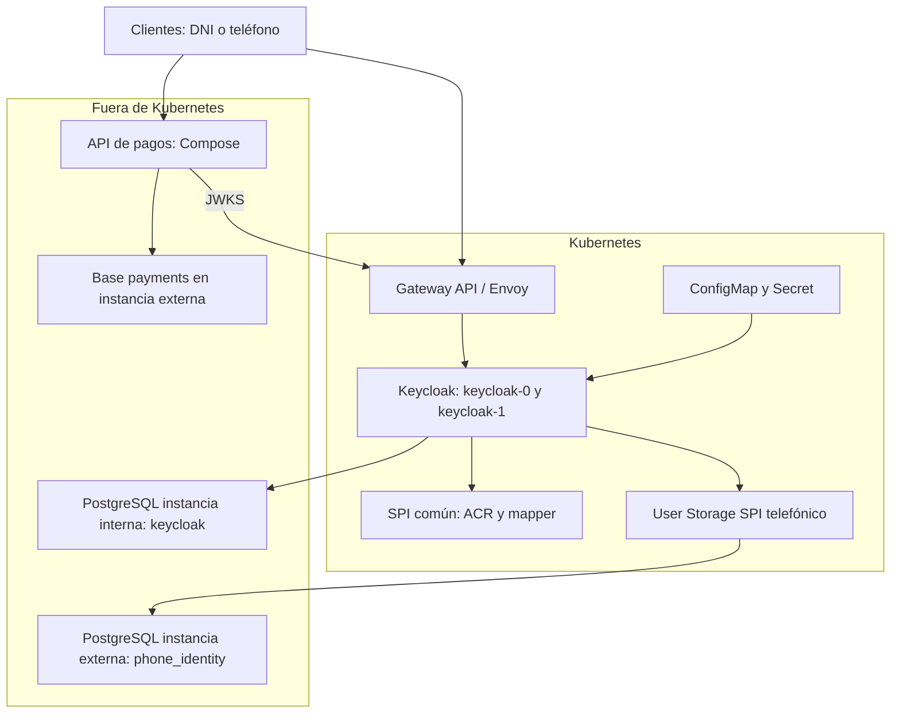

# Keycloak SPI y autorización ACR para procesamiento de pagos

Se implementa una PoC de identidad centrada en Keycloak: se extiende el servidor mediante un SPI común, tres módulos de 
autenticación y federación de usuarios mediante User Storage SPI. Se autentica con identificador y contraseña en cada flujo, se 
establece el ACR en el servidor y se aplica autorización contextual en una API de pagos. El procesamiento de pagos permite observar el efecto de cada flujo; no se integra una red adquirente ni se procesan tarjetas reales.

## Caso de uso técnico

Se habilitan 3 flujos de autenticación independientes en el realm `axiz`.

| Flujo | Cliente | Identificador | Origen de credenciales | ACR emitido | Operaciones permitidas |
| --- | --- | --- | --- | --- | --- |
| Authorization Code con PKCE S256 | `payments-web` | DNI de ocho dígitos | Base interna de Keycloak | `5` | Consultar, crear y aprobar pagos |
| Resource Owner Password / Direct Grant | `payments-password` | DNI de ocho dígitos | Base interna de Keycloak | `4` | Consultar y crear pagos |
| Login telefónico personalizado | `payments-phone` | Teléfono peruano en E.164 | Base PostgreSQL externa | `3` | Consultar pagos propios |

El login personalizado se integra como un flujo Direct Grant independiente, con cliente, Authenticator SPI y User Storage SPI propios.
Se envía el teléfono en el parámetro OIDC `username` y la clave en `password`. Se conserva el endpoint estándar de emisión de tokens;
no se construyen JWT ni se implementa un endpoint paralelo que omita las comprobaciones de Keycloak.

## Caso funcional

Se permite registrar una orden de pago con monto y moneda, consultar las órdenes del usuario autenticado y aprobar una orden 
pendiente. Se verifica la firma del JWT, emisor, expiración, audiencia `payments-api`, rol `merchant` y ACR antes de ejecutar la 
operación. Se utilizan claves de idempotencia independientes por sujeto; una repetición conserva el identificador original y un 
cambio de contenido devuelve conflicto.

La identidad del propietario se obtiene de `sub`, no de parámetros del request. Se restringen las consultas y aprobaciones al mismo propietario. Se utiliza una actualización condicional para que una orden solo transicione de `PENDING` a `APPROVED` una vez.

## Tecnologías y compatibilidad

| Tecnología | Versión seleccionada | Uso |
| --- | --- | --- |
| Keycloak | 26.8.0 | Servidor OIDC y runtime de los SPI |
| Java de extensiones | Bytecode 21 | Compatibilidad con Java 21 de la imagen oficial de Keycloak |
| Java de pagos | 25 | Compilación y ejecución del servicio Spring |
| Spring Boot | 4.1.1 | Gestión consistente de dependencias y configuración |
| Spring Framework | 7.0.9, administrado por Boot | MVC, JDBC, validación e inyección |
| Spring Security | 7.1.1, administrado por Boot | Resource Server JWT y cliente OIDC con PKCE |
| Flyway | 12.4.0, administrado por Boot | Migración exclusiva del esquema de pagos |
| PostgreSQL | 18.6 | Persistencia de Keycloak, identidad externa y pagos |
| Maven | 3.10.0 en imagen de compilación | Reactor de cinco módulos y pruebas |
| Spotless / google-java-format | 3.10.4 / 1.36.1 | Formato reproducible de Java |
| kind / Kubernetes | 0.33.0 / 1.36.4 | Aprovisionamiento de un clúster local |
| Helm | 4.3.0 | Instalación y actualización de Keycloak en Kubernetes |
| Python | 3.14.8 en el contenedor de carga | Admin REST con librería estándar, sin dependencias adicionales |
| Envoy Gateway / Gateway API | 1.9.2 / 1.6.1 | Controlador y proxy de exposición HTTP mediante Gateway y HTTPRoute |

## Arquitectura



En Kubernetes se despliegan dos réplicas de la distribución estable Keycloak, con imagen optimizada y chart propio. Se instalan 
Envoy Gateway y las CRD de Gateway API mediante el chart oficial; GatewayClass, EnvoyProxy, Gateway y HTTPRoute exponen el servicio
ClusterIP de Keycloak. Se utiliza la rama estable compatible con Kubernetes 1.36. No se crean workloads, PVC ni Jobs PostgreSQL 
dentro del clúster. La API de pagos se ejecuta en Compose.

## Estructura del proyecto

```text
pom.xml                     Reactor Maven de cinco módulos
README.md                   Documentación completa de la PoC
.env.example                Configuración de ejemplo
common-spi/                 Política ACR, SPI propio y protocol mapper
auth-code-dni-spi/           Autenticación web DNI y clave, ACR 5
ropc-dni-spi/                Autenticación Direct Grant DNI y clave, ACR 4
external-auth-phone-spi/     Autenticación teléfono y clave, User Storage y ACR 3
payment-service/            API hexagonal, portal OIDC y migración Flyway
infrastructure/             Compose, imágenes, arranque único, aprovisionamiento y chart Helm
  datasets/                 Realm, SQL externo y generador de hashes
    postman/                Colección de pruebas y entorno importable
tests/                      Pruebas HTTP/OIDC y validación estática
dist/                       JAR compilados de los cinco módulos
verification/               Evidencia de validación del paquete
```

Se conservan muestras de request y response en `infrastructure/requests` e `infrastructure/responses`. Los identificadores de esas 
muestras son ilustrativos y no representan datos ya insertados. Toda la explicación se concentra en este archivo. Los archivos de 
configuración mantienen únicamente los comentarios necesarios en español.

## Código principal

En `common-spi`, `AcrPolicySpi` declara el SPI `axiz-acr-policy`. `AcrPolicyProviderFactory` define su contrato de factory y `AcrPolicyFactory` registra el proveedor `default` mediante `META-INF/services`. Se guardan `axiz_acr` y `axiz_flow` como notas de sesión desde el contexto de autenticación validado.

`AcrMapper` publica `acr` y `auth_flow` en access token e ID token. Se obtiene el valor desde la sesión de Keycloak, no desde un atributo modificable del usuario ni desde `acr_values` enviado por el cliente. Se conserva el valor al renovar el token. Una sesión sin ACR verificado no puede emitir tokens con este mapper.

En `auth-code-dni-spi`, `AuthCodeDniAuthenticator` extiende `UsernamePasswordForm`: se muestra el formulario de Keycloak, se comprueba el DNI y el origen interno, y se autentica la contraseña con el gestor nativo de credenciales. Se conservan el manejo del formulario, los eventos y la protección contra fuerza bruta del servidor. Se establece ACR 5 únicamente después de autenticar correctamente.

En `ropc-dni-spi`, `RopcDniAuthenticator` realiza la resolución del usuario interno por DNI y la comprobación de contraseña en una sola ejecución. En `external-auth-phone-spi`, `ExternalAuthPhoneAuthenticator` resuelve el teléfono mediante el componente `external-auth-phone-storage` y autentica la contraseña mediante `credentialManager().isValid`, que delega en `PhoneStorage`. Se utiliza `CredentialGrantAuthenticator` como implementación compartida del procesamiento de credenciales, estados de usuario, bloqueo por fuerza bruta, errores OAuth y eventos. Se registra `PASSWORD_VALIDATED` y el tipo de credencial password al completar la autenticación. No se agregan ejecuciones separadas de `direct-grant-validate-username` o `direct-grant-validate-password` a estos flujos.

Cada factory implementa `ServerInfoAwareProviderFactory`. Se genera `Implementation-Version` desde `${project.version}` en el manifiesto de cada JAR durante el build y se publica en la información operativa de Keycloak. Se lee la versión del JAR de cada factory, de modo que una mezcla accidental de versiones no quede oculta por la versión del módulo común. En **Server info → Provider info** se consulta `version=1.1.0` para los tres autenticadores, el proveedor común y User Storage. En **Authentication → Flows → Add execution** se visualizan los nombres `Authorization Code DNI / v1.1.0 / ACR 5`, `ROPC DNI / v1.1.0 / ACR 4` y `External Auth teléfono / v1.1.0 / ACR 3`. Los IDs permanecen estables al cambiar una versión, de modo que no se rompan los bindings del realm.

`PhoneStorage` implementa `UserLookupProvider` y `CredentialInputValidator` y `CredentialInputUpdater` de solo lectura. Se rechazan modificaciones de contraseña desde Keycloak. Se consultan identidades externas mediante JDBC, timeouts y sentencias preparadas; se utilizan conexiones de solo lectura lógico con un usuario que solo dispone de `SELECT`. No se importan identidades ni contraseñas a la tabla interna de usuarios. Se verifican hashes PBKDF2-HMAC-SHA256 de 256 bits, salt de 128 bits y 600 000 iteraciones mediante comparación de tiempo constante. Se desactiva la caché de usuarios externos para que la deshabilitación se consulte en la base. El dataset incluye salts diferentes por usuario; el generador permite regenerarlos con una clave nueva.

Se mantiene el bloqueo por intentos fallidos mediante los servicios nativos de protección contra fuerza bruta, se deshabilitan 
registro libre, login por correo e implicit grant, y se activa rotación de refresh tokens. Se restringen los roles de cada cliente 
mediante scope mappings explícitos. El flujo web exige revalidar las credenciales en cada nuevo recorrido: se omite deliberadamente 
la ejecución Cookie para que una sesión de ACR 3 o 4 no permita obtener ACR 5 sin introducir el DNI y la contraseña.


## Web de login del Authorization Code Flow

Se utiliza el tema nativo `axiz` de Keycloak para la pantalla de DNI y contraseña. Se adapta la experiencia visual del diseño de referencia Angular: fondo oscuro, paneles laterales, tarjeta central, acentos celestes, logotipo Axiz y distribución responsive. Se utiliza FreeMarker, el motor de plantillas de Keycloak, para mantener el formulario y el procesamiento de credenciales en el servidor de identidad.

### Ubicación del código de la web

| Archivo | Cambio que se realiza |
| --- | --- |
| `themes/axiz/login/login.ftl` | Formulario, campos y composición del login de DNI; se conserva action dinámico, POST, username, password, credentialId e identificación del formulario |
| `themes/axiz/login/template.ftl` | Distribución de la pantalla, paneles, cabecera, tarjeta, enlaces y pie |
| `themes/axiz/login/resources/css/axiz-login.css` | Colores, tipografía, botones, campos, espaciado y comportamiento responsive |
| `themes/axiz/login/messages/messages_es.properties` | Textos visibles en español; DNI, contraseña, ingreso, ayuda y contenido de los paneles |
| `themes/axiz/login/messages/messages.properties` | Textos de respaldo del tema |
| `themes/axiz/login/resources/img/` | Logotipo y favicon utilizados en la interfaz Axiz |
| `themes/axiz/login/theme.properties` | Herencia de keycloak.v2, estilos, recursos y versión del tema |
| `payment-service/src/main/java/pe/axiz/payments/adapters/PortalController.java` | Página inicial en `http://localhost:8090/`; se inicia el flujo mediante `/oauth2/authorization/axiz` |
| `auth-code-dni-spi/src/main/java/pe/axiz/identity/authcode/AuthCodeDniAuthenticator.java` | Autenticación del DNI y establecimiento de ACR 5; la apariencia se modifica en el tema, no en el SPI |

Se distinguen la página inicial del servicio de pagos y el formulario servido por Keycloak en el puerto 8080. Se conservan `kc-form-login`, los nombres de los campos, las cookies y la acción del formulario para mantener las pruebas Postman, PKCE y sesiones cruzadas. Los valores del formulario se escapan mediante las plantillas de Keycloak y la contraseña se verifica en el servidor. El tema y los estilos no emiten tokens ni guardan credenciales en el navegador.

### Publicación del tema

El tema se incorpora en `/opt/keycloak/themes/axiz` mediante `infrastructure/Dockerfile.keycloak`. Se conserva la caché de dependencias de la imagen base. Se utiliza el chart 1.5.0 con las dos instancias, Gateway API y las bases externas existentes. Tras el rollout, `seed-keycloak.py` configura el tema y el idioma español del realm `axiz` mediante Admin REST; se aplica también a una base ya inicializada. La consola administrativa del realm `master` conserva su tema.

Con la infraestructura activa se ejecuta desde la raíz:

```bash
bash infrastructure/deploy-k8s.sh --build
```

Para levantar todo con las pruebas existentes:

```bash
bash infrastructure/start-all.sh --build --test
```

Se abre `http://localhost:8090/` y se selecciona **Iniciar sesión** para llegar al nuevo formulario. No se abre una URL `/auth` incompleta: el cliente genera los parámetros de Authorization Code y PKCE. Se comprueba DNI `12345678` con su clave configurada y el rechazo de una clave incorrecta. Tras un cambio de recursos estáticos se recarga el navegador sin utilizar su caché. Se reconstruye y publica la imagen para distribuir la misma versión del tema en ambas instancias.

Las plantillas se alinean con Keycloak 26.8.0 y extienden `keycloak.v2`. Se revisan al actualizar Keycloak, especialmente los formularios, recursos y scripts heredados. La referencia técnica del mecanismo es https://www.keycloak.org/ui-customization/themes.

## Preparación

```bash
cp .env.example .env
chmod 600 .env
```
## Datos iniciales

Se importan el rol `merchant`, tres clientes, los bindings y los flujos desde `infrastructure/datasets/axiz-realm.json`. Se resuelven los secretos de clientes durante la importación de Keycloak. Los usuarios internos se generan mediante `infrastructure/seed-keycloak.sh` y su implementación Admin REST `seed-keycloak.py`, con operaciones idempotentes de creación, actualización de perfil, asignación de contraseña y rol.

| Origen | Identificadores de prueba | Estado | Uso |
| --- | --- | --- | --- |
| Keycloak interno | `12345678`, `87654321`, `11223344` | Habilitados | DNI + clave en Authorization Code o ROPC |
| Keycloak interno | `22334455` | Deshabilitado | Rechazo de autenticación |
| Instancia externa | `+51987654321`, `+51912345678` | Habilitados | Teléfono + clave en flujo externo |
| Instancia externa | `+51911111111` | Deshabilitado | Rechazo de autenticación externa |

Se incluyen nombre, apellido y correo sintéticos para satisfacer el perfil de Keycloak sin acciones interactivas pendientes. Las identidades telefónicas se consultan en la base externa y no se importan como usuarios internos; su clave inicial es `Telefono2026!`. Para regenerar los hashes antes del primer arranque:

```bash
bash infrastructure/datasets/generate.sh
```

Se ingresa la nueva clave sin mostrarla en terminal y se actualiza su valor de demostración en `.env`. Se generan salts independientes para cada fila. El generador modifica el dataset y no una base ya inicializada.

`infrastructure/datasets/postgres-keycloak-init.sh` inicializa exclusivamente el rol y la base de Keycloak en la primera instancia. `infrastructure/postgres-external-init.sh` inicializa roles, base telefónica y base de pagos en la segunda instancia y aplica `infrastructure/datasets/phone-seed.sql`. Flyway administra exclusivamente el esquema de pagos mediante `V1__payment.sql`; Keycloak administra su esquema mediante sus propias migraciones. No se duplica la creación de esquemas.

Se ejecuta el servicio de carga `seed-keycloak` de Compose tras el arranque del realm en Kubernetes; el despliegue Kubernetes ejecuta el mismo script en un contenedor una vez que el Gateway está disponible. Para volver a cargar los usuarios sintéticos:

```bash
bash infrastructure/seed-keycloak.sh
```

Se restablecen las contraseñas, los perfiles y los estados de esos usuarios de demostración. Se imprime cada DNI aprovisionado y las versiones de los proveedores, sin imprimir contraseñas ni tokens. El script espera la disponibilidad del realm durante un máximo de cuatro minutos. La importación no reemplaza un realm existente y los scripts PostgreSQL solo se ejecutan al inicializar un volumen vacío.

## Imagen base reutilizable

Compose construye primero `axiz/java-build-base:1.1.0` mediante `additional_contexts`, antes de compilar Keycloak y pagos. Se 
declara la dependencia de build explícitamente para evitar que Docker intente descargar la imagen privada de Docker Hub. El 
servicio de construcción se declara sin perfil y con `scale: 0`: queda disponible para resolver `additional_contexts` tanto con el perfil `app` como en el modo de infraestructura, pero no se crean contenedores para ese servicio. Se evita depender de que Compose resuelva servicios excluidos por un perfil. No se requiere activar otro perfil ni ejecutar una construcción manual antes del primer arranque.

Ante el error `declares unknown service "java-build-base" as additional contexts java_build_base`, se comprueba que la definición 
de `java-build-base` tenga `scale: 0` y no declare `profiles`. La configuración anterior reproducía ese fallo en Compose 2.39.4 al utilizar `--profile app`; se validaron el modelo y los grafos de build corregidos en Compose 2.39.4 y 5.6.0. Se reemplaza el archivo Compose con el incluido en este paquete.

```bash
bash infrastructure/build-base.sh
```

La imagen final Keycloak incluye los cuatro JAR y ejecuta `kc.sh build` durante la construcción, no en cada arranque. Las 
imágenes de aplicación se conservan como `axiz/keycloak:1.1.0` y `axiz/payments:1.1.0`; un arranque con `--no-build` no recompila ni instala dependencias. Las imágenes finales no contienen Maven ni el repositorio de dependencias.

## Composición de los servicios externos

`infrastructure/docker-compose.yml` define las dos instancias PostgreSQL independientes, pagos, la red externa `kind` y el contenedor de carga de usuarios. Se utilizan los volúmenes persistentes `keycloak-pgdata` y `external-pgdata` del proyecto Compose `axiz-identity`.

Se declaran `java-build-base` y `keycloak` con `scale: 0` exclusivamente como objetivos de construcción de imágenes. Compose no ejecuta el servidor Keycloak. Su única instancia de aplicación se despliega mediante el chart Helm. Se utiliza el script completo de la siguiente sección para crear la red del clúster antes de levantar los servicios que dependen de ella.

## Kubernetes local y representatividad

Se utiliza kind 0.33.0 con Kubernetes 1.36.4. Se ejecutan nodos Kubernetes reales como contenedores Docker y se 
utiliza kubeadm para su aprovisionamiento. Se considera suficiente para comprobar Authenticator SPI, User Storage, Helm, 
Secrets, ConfigMaps, StatefulSet, sondas, resolución de servicios y Gateway API. Se conservan los mismos recursos Kubernetes 
que pueden instalarse en otro clúster compatible. Las URL de bases externas y la exposición del Gateway se adaptan al entorno destino.

Se conserva el chart local en la versión 1.4.0 y los binarios Java en 1.1.0. Se distingue la validación funcional de la validación operativa de producción. El clúster local de un nodo no acredita alta disponibilidad, balanceadores cloud, almacenamiento distribuido, recuperación ante pérdida del nodo, TLS público ni políticas de red de una plataforma destino. Esas propiedades requieren pruebas en un clúster con la infraestructura correspondiente. Referencias: [kind](https://kind.sigs.k8s.io/), [K3s](https://docs.k3s.io/) y [minikube](https://minikube.sigs.k8s.io/docs/).

## Arranque completo con Kubernetes y Compose

Se ejecuta desde la raíz un único comando, con Docker Engine disponible:

```bash
bash infrastructure/start-all.sh --build
```

Se crea `.env` a partir del ejemplo si no existe. Se comprueban Docker, Compose, curl y Python 3 para utilidades de aprovisionamiento. Los servicios de aplicación, las dos instancias PostgreSQL, la carga de usuarios y los runners de pruebas se ejecutan en contenedores. En el host solo se ejecutan las herramientas de orquestación. No se necesita Java ni Maven en el host para ejecutar este modo.

Se sigue esta secuencia según las dependencias:

- Se detienen únicamente los contenedores del modo Compose alternativo que ocupan los puertos de Keycloak y pagos. Se conservan los volúmenes y la instancia externa ya existente.
- Se instalan kind, Helm y kubectl en `.tools` cuando no están disponibles, con comprobación de integridad. Se crea o reutiliza el clúster `axiz` y se espera que su nodo esté disponible. Se conserva el kubeconfig privado en `.runtime/kubeconfig` sin cambiar el contexto global del usuario.
- Se levantan las dos instancias PostgreSQL con `infrastructure/docker-compose.yml` y se espera su estado saludable. Los scripts iniciales crean roles y bases únicamente sobre volúmenes vacíos; la segunda instancia carga las identidades telefónicas.
- Se conectan ambos contenedores de base de datos a la red Docker `kind` y se obtienen sus IP privadas. Se construye la imagen de Keycloak, incluida la base compartida, y se carga en el nodo kind.
- Se instala Envoy Gateway con su chart oficial. Se instala o actualiza el chart `infrastructure/helm/axiz`, que administra el StatefulSet de Keycloak con todos los SPI, Service, ConfigMap, Secret, GatewayClass, EnvoyProxy, Gateway y HTTPRoute. No contiene workloads PostgreSQL ni el servicio de pagos.
- Se espera el rollout de Keycloak y la condición `Programmed` del Gateway. Se ejecuta la carga idempotente de usuarios en un contenedor Python conectado a `kind`.
- Se construye y levanta el contenedor de pagos en Compose. Se alcanza Keycloak por `axiz-control-plane:30080` desde la red Docker compartida y se conserva `localhost:8080` como emisor y URL pública del navegador. Se espera `/ready`; Flyway aplica el esquema de pagos durante el arranque. Se imprimen todas las rutas disponibles.

Se reutilizan las imágenes existentes con:

```bash
bash infrastructure/start-all.sh --no-build
```

Para arrancar y ejecutar también las comprobaciones
HTTP/OIDC en un contenedor antes de dejar los logs activos:

```bash
bash infrastructure/start-all.sh --build --test
```

## Sesiones compartidas entre instancias

Se ejecutan `keycloak-0` y `keycloak-1` con la misma imagen, los mismos SPI y la base PostgreSQL propia de Keycloak compartida. Se conserva la instancia PostgreSQL externa independiente para las identidades telefónicas. Se utiliza Infinispan embebido en modo `ispn` y descubrimiento `jdbc-ping`, predeterminado de Keycloak 26.8. No se instala un servidor Infinispan externo. Se enlaza el transporte a la IP de cada Pod, se utiliza su nombre como identificador y se mantiene mTLS entre instancias. Los puertos 7800 y 57800 no se publican en el Gateway.

Las sesiones de usuario y cliente se persisten mediante las capacidades nativas de Keycloak; las sesiones de autenticación y las invalidaciones utilizan sus cachés distribuidas. No se replica estado desde los SPI. Se mantiene el flujo web sin ejecución Cookie para evitar elevar sesiones de ACR 3/4 a ACR 5 sin revalidar credenciales: estas pruebas comprueban continuidad de sesiones y refresh, sin agregar SSO automático por cookie.

Cada Pod dispone de un Service con selector `statefulset.kubernetes.io/pod-name`. HTTPRoute permite elegirlo mediante `X-Axiz-Instance: keycloak-0` o `keycloak-1` y devuelve esa cabecera como evidencia de la ruta seleccionada. Sin cabecera se utiliza el Service balanceado normal. Se reservan estas rutas explícitas para la PoC local; no constituyen un permiso de acceso. Los endpoints administrativos mantienen su autenticación normal.

Con el despliegue activo se ejecuta desde la raíz:

```bash
bash tests/run-ha.sh
```

Se comprueban los Pods Ready, los EndpointSlices de cada Service y la última vista Infinispan `ISPN000094` de ambos procesos. Después se ejecuta el runner Python en un contenedor Compose. Se guardan resultados sin tokens ni contraseñas en `.runtime/ha-session-results.json`.

| Prueba | Comprobación |
|---|---|
| Authorization Code cruzado | Se abre el formulario en una instancia, se autentica DNI en la otra y se intercambia el código en la primera con PKCE S256, state y nonce |
| DNI y teléfono | Se crean sesiones con ACR 4 y 3 en la instancia elegida |
| Sesión compartida | Admin REST devuelve el mismo identificador de sesión desde ambas instancias |
| Usuario y renovación | UserInfo acepta el token en la otra instancia; se renueva en ambas conservando sujeto, identificador de sesión, flujo y ACR |
| Cierre propagado | Se elimina exclusivamente la sesión de prueba desde la otra instancia; desaparece en la primera y su refresh se rechaza con invalid_grant |
| Dirección inversa | Se repiten los tres flujos intercambiando keycloak-0 y keycloak-1 |

No se utiliza únicamente `/api/identity` como evidencia: validar una firma JWT no demostraría sesión activa compartida. No se cierran todas las sesiones del usuario ni la sesión administrativa del navegador.

Las pruebas compartidas se incluyen en `bash tests/run-all.sh` y en el arranque completo:

```bash
bash infrastructure/start-all.sh --build --test
```

Con imágenes existentes se aplica el nuevo chart con `bash infrastructure/start-all.sh --no-build --test`. Se recomienda disponer de 8 GiB de memoria para Docker. El kind suministrado mantiene un nodo: dos procesos permiten probar continuidad entre instancias, pero no tolerancia a la pérdida del único nodo ni de las bases externas.

Para inspeccionar ambas instancias:

```bash
export PATH="$PWD/.tools:$PATH"
export KUBECONFIG="$PWD/.runtime/kubeconfig"
kubectl -n axiz get statefulset,pods,services,poddisruptionbudgets
kubectl -n axiz logs keycloak-0 | rg ISPN000094
kubectl -n axiz logs keycloak-1 | rg ISPN000094
curl -i -H 'X-Axiz-Instance: keycloak-0' http://localhost:8080/realms/axiz/.well-known/openid-configuration
curl -i -H 'X-Axiz-Instance: keycloak-1' http://localhost:8080/realms/axiz/.well-known/openid-configuration
```

## Actualización individual del chart

Con las bases del modo anterior disponibles, se puede actualizar únicamente Keycloak:

```bash
bash infrastructure/deploy-k8s.sh --build
```

Se resuelve la revisión de imagen mediante su ID Docker y se añade a las anotaciones del StatefulSet. Una imagen diferente provoca el rollout aunque se conserve la etiqueta local. Se carga en kind antes de aplicar Helm. Se mantiene el ID de los proveedores y se visualiza la versión de cada JAR en la consola de Keycloak.

## Actualización de los SPI

Los SPI Java no se recargan en caliente en Keycloak. Para añadir, sustituir o retirar un JAR se reconstruye el registro de proveedores con `kc.sh build` y se inicia de nuevo el servidor. En esta PoC esa operación ya se realiza al construir la imagen optimizada. Se actualiza únicamente la imagen de Keycloak; se conservan las bases externas, el realm persistido, Secrets y recursos del Gateway.

Los cambios de configuración del realm, clientes, bindings y ejecuciones de flujos existentes se aplican mediante consola o Admin REST sin sustituir un JAR. Se distingue ese cambio de configuración de una nueva implementación compilada. La importación inicial del realm no se utiliza para sobrescribir un realm existente.

Para cambiar código se incrementa la versión Maven del artefacto y se actualizan sus referencias de build y JAR; la consola muestra la versión del manifiesto efectivamente desplegado. Se conservan los IDs de los proveedores para mantener los bindings. Si cambia una dependencia se actualiza la base mediante el build de Compose; un cambio de código con las mismas dependencias reutiliza su caché.

## Endpoints en orden de ejecución

| Método | Ruta | Descripción funcional | Descripción técnica |
| --- | --- | --- | --- |
| GET | `:8080/realms/axiz/.well-known/openid-configuration` | Descubrir el proveedor de identidad | Metadata OIDC; permite comprobar importación |
| GET | `:8090/` | Abrir el portal de demostración | Inicio público del cliente web |
| GET | `:8090/oauth2/authorization/axiz` | Iniciar sesión con DNI | Spring genera state, nonce y PKCE S256 |
| GET | `:8080/realms/axiz/protocol/openid-connect/auth` | Presentar formulario Keycloak | Authorization Code para `payments-web` |
| GET | `:8090/login/oauth2/code/axiz` | Completar la sesión web | Callback validado por Spring; intercambio de código |
| GET | `:8090/portal` | Consultar identidad de sesión | Se devuelve username, ACR y flujo sin exponer tokens |
| POST | `:8080/realms/axiz/protocol/openid-connect/token` | Obtener o renovar tokens | Código+PKCE, Direct Grant DNI/teléfono y refresh |
| GET | `:8080/admin/realms/axiz/users/{id}/sessions` | Comprobar la sesión creada en otra instancia | Admin REST, token administrativo y ruta determinista mediante X-Axiz-Instance |
| DELETE | `:8080/admin/realms/axiz/sessions/{sid}` | Cerrar exclusivamente la sesión de prueba | Se verifica su desaparición y el rechazo de refresh desde la otra instancia |
| GET | `:8080/realms/axiz/protocol/openid-connect/certs` | Consultar claves públicas | JWKS para validar firma JWT |
| GET | `:8090/api/identity` | Consultar identidad del access token | JWT válido con audiencia `payments-api` |
| GET | `:8090/api/payments` | Consultar pagos propios | `merchant`, ACR mínimo 3 y filtro por `sub` |
| POST | `:8090/api/payments` | Registrar una orden de pago | `merchant`, ACR mínimo 4 e idempotencia |
| POST | `:8090/api/payments/{id}/approve` | Aprobar una orden pendiente | `merchant`, ACR mínimo 5 y propietario |
| GET | `:8080/realms/axiz/protocol/openid-connect/userinfo` | Consultar perfil OIDC | Access token y scope `openid` |
| POST | `:8080/realms/axiz/protocol/openid-connect/revoke` | Revocar credenciales de sesión | Endpoint estándar con autenticación de cliente |
| GET/POST | `:8080/realms/axiz/protocol/openid-connect/logout` | Terminar sesión | Logout OIDC; se aplican parámetros estándar |
| GET | `:8090/ready` | Comprobar proceso de pagos disponible | Sonda HTTP sin autenticación |
| GET | `:8080/admin/` | Administrar realm, usuarios y clientes | Consola administrativa; cuenta bootstrap separada |

La ruta `http://localhost:8090/callback-test` está registrada únicamente para que la prueba automatizada capture la redirección 
OIDC sin añadir un controlador que exponga códigos. El script intercepta la redirección y no navega a esa ruta.

## Pruebas manuales mediante curl

Se cargan las propiedades en la terminal desde la raíz:

```bash
set -a
source .env
set +a
TOKEN_URL="$KEYCLOAK_PUBLIC_URL/realms/axiz/protocol/openid-connect/token"
```

### Descubrimiento del realm

Se confirma que Keycloak está disponible y que el realm se ha importado:

```bash
curl -fsS "$KEYCLOAK_PUBLIC_URL/realms/axiz/.well-known/openid-configuration" | python3 -m json.tool
```

Se obtiene metadata JSON con `issuer`, `authorization_endpoint`, `token_endpoint` y `jwks_uri`.

### Teléfono mediante almacenamiento externo

Se consulta la base externa, se verifica el hash y se obtiene ACR 3. Se utiliza `--data-urlencode` para conservar el signo `+` del teléfono:

```bash
PHONE_RESPONSE=$(curl -fsS -X POST "$TOKEN_URL" \
  --data-urlencode 'grant_type=password' \
  --data-urlencode 'client_id=payments-phone' \
  --data-urlencode "client_secret=$PHONE_CLIENT_SECRET" \
  --data-urlencode 'username=+51987654321' \
  --data-urlencode "password=$PHONE_DEMO_PASSWORD" \
  --data-urlencode 'scope=openid')
PHONE_TOKEN=$(printf '%s' "$PHONE_RESPONSE" | python3 -c 'import json,sys; print(json.load(sys.stdin)["access_token"])')
curl -fsS -H "Authorization: Bearer $PHONE_TOKEN" http://localhost:8090/api/identity
curl -fsS -H "Authorization: Bearer $PHONE_TOKEN" http://localhost:8090/api/payments
```

Se devuelve `{"subject":"f:componente:telefono","acr":"3","flow":"phone"}` y una lista vacía si todavía no existen pagos propios.

### Rechazo de una creación con ACR 3

Se verifica la autorización funcional, aun cuando la autenticación haya sido válida:

```bash
curl -sS -o /dev/null -w 'HTTP %{http_code}\n' \
  -H "Authorization: Bearer $PHONE_TOKEN" \
  -H 'Content-Type: application/json' \
  -H 'Idempotency-Key: phone-denied-2026' \
  -d '{"amount":100.50,"currency":"PEN"}' \
  http://localhost:8090/api/payments
```

Se espera HTTP 403 y no se registra ningún pago.

### DNI mediante Resource Owner Password

Se autentica el DNI y su contraseña contra las credenciales internas de Keycloak y se obtiene ACR 4:

```bash
DNI_RESPONSE=$(curl -fsS -X POST "$TOKEN_URL" \
  --data-urlencode 'grant_type=password' \
  --data-urlencode 'client_id=payments-password' \
  --data-urlencode "client_secret=$PASSWORD_CLIENT_SECRET" \
  --data-urlencode 'username=12345678' \
  --data-urlencode "password=$DNI_PASSWORD" \
  --data-urlencode 'scope=openid')
DNI_TOKEN=$(printf '%s' "$DNI_RESPONSE" | python3 -c 'import json,sys; print(json.load(sys.stdin)["access_token"])')
curl -fsS -H "Authorization: Bearer $DNI_TOKEN" http://localhost:8090/api/identity
```

Respuesta de identidad, con `subject` variable:

```json
{"subject":"identificador-interno","acr":"4","flow":"password"}
```

La respuesta de token incluye `access_token`, `refresh_token`, `id_token`, `expires_in` y `token_type`. No se imprimen los tokens en los logs del servicio.

### Creación e idempotencia con ACR 4

Se registra una orden pendiente con el DNI:

```bash
PAYMENT_RESPONSE=$(curl -fsS \
  -H "Authorization: Bearer $DNI_TOKEN" \
  -H 'Content-Type: application/json' \
  -H 'Idempotency-Key: dni-payment-2026' \
  -d '{"amount":100.50,"currency":"PEN"}' \
  http://localhost:8090/api/payments)
printf '%s\n' "$PAYMENT_RESPONSE"
PAYMENT_ID=$(printf '%s' "$PAYMENT_RESPONSE" | python3 -c 'import json,sys; print(json.load(sys.stdin)["id"])')
```

Respuesta HTTP 200:

```json
{"id":"uuid","owner":"identificador-interno","amount":100.50,"currency":"PEN","status":"PENDING"}
```

Se repite exactamente el mismo request para comprobar que se devuelve el mismo `id`. Se modifica el monto conservando la clave para comprobar HTTP 409 con `{"error":"La clave de idempotencia ya contiene otro pago"}`.

### Rechazo de aprobación con ACR 4

```bash
curl -sS -o /dev/null -w 'HTTP %{http_code}\n' -X POST \
  -H "Authorization: Bearer $DNI_TOKEN" \
  "http://localhost:8090/api/payments/$PAYMENT_ID/approve"
```

Se espera HTTP 403. Se mantiene la orden pendiente.

### Authorization Code con PKCE y ACR 5

Se abre `http://localhost:8090/`, se inicia sesión con DNI `12345678` y su clave y se consulta `/portal`. Se devuelve `{"username":"12345678","acr":"5","flow":"code"}`. El navegador inicia un Authorization Code real; Spring genera PKCE S256, state y nonce y valida el callback.

Para obtener el access token del mismo recorrido mediante el cliente de pruebas y utilizarlo en curl:

```bash
mkdir -p .runtime
umask 077
bash tests/token-code.sh > .runtime/code-response.json
CODE_TOKEN=$(python3 -c 'import json; print(json.load(open(".runtime/code-response.json"))["access_token"])')
curl -fsS -H "Authorization: Bearer $CODE_TOKEN" http://localhost:8090/api/identity
curl -fsS -H "Authorization: Bearer $CODE_TOKEN" http://localhost:8090/api/payments
```

Se inicia `/auth` con PKCE, state y nonce, se envía DNI y contraseña al formulario Keycloak y se intercepta el código del redirect URI autorizado. Se intercambia ese código en `/token` con `grant_type=authorization_code`, `client_id=payments-web`, `redirect_uri=http://localhost:8090/callback-test`, `code` y el `code_verifier` original. Se comprueban state, nonce, ACR 5 y rechazo de un segundo intercambio. No se utiliza un password grant para generar este token. La respuesta guardada contiene `access_token`, `id_token`, `refresh_token`, `token_type` y expiración; los valores completos se mantienen en el archivo privado.

El intercambio equivalente por curl, si se captura el código con el navegador y se conserva el verificador original, es:

```bash
CODE_RESPONSE=$(curl -fsS -X POST "$TOKEN_URL" \
  --data-urlencode 'grant_type=authorization_code' \
  --data-urlencode 'client_id=payments-web' \
  --data-urlencode 'redirect_uri=http://localhost:8090/callback-test' \
  --data-urlencode "code=$AUTHORIZATION_CODE" \
  --data-urlencode "code_verifier=$PKCE_VERIFIER")
CODE_TOKEN=$(printf '%s' "$CODE_RESPONSE" | python3 -c 'import json,sys; print(json.load(sys.stdin)["access_token"])')
```

Se devuelve `{"subject":"identificador-interno","acr":"5","flow":"code"}` al consultar la identidad. Se aprueba el pago creado anteriormente por el mismo DNI:

```bash
curl -fsS -X POST -H "Authorization: Bearer $CODE_TOKEN" \
  "http://localhost:8090/api/payments/$PAYMENT_ID/approve"
```

Se espera HTTP 200 con `{"status":"APPROVED"}`. Una segunda aprobación devuelve 404 por la actualización condicional. El sujeto del DNI es el mismo en ROPC y Authorization Code; el teléfono mantiene un sujeto externo independiente.

### Renovación y persistencia de ACR

```bash
REFRESH_TOKEN=$(printf '%s' "$DNI_RESPONSE" | python3 -c 'import json,sys; print(json.load(sys.stdin)["refresh_token"])')
curl -fsS -X POST "$TOKEN_URL" \
  --data-urlencode 'grant_type=refresh_token' \
  --data-urlencode 'client_id=payments-password' \
  --data-urlencode "client_secret=$PASSWORD_CLIENT_SECRET" \
  --data-urlencode "refresh_token=$REFRESH_TOKEN"
```

Se obtiene un nuevo par de tokens y se mantiene ACR 4. Se utiliza el nuevo refresh token para futuras renovaciones. La reutilización del anterior se rechaza con HTTP 400. La revocación de un refresh token no invalida instantáneamente un access token validado offline; este último mantiene su validez hasta expirar.

### Credenciales incorrectas y separación de flujos

Se repite el request de DNI con una contraseña incorrecta; se espera `invalid_grant` y HTTP 400. Se envía el teléfono y su clave al cliente `payments-password`, o el DNI al cliente `payments-phone`; se espera igualmente rechazo. Se envía `acr_values=5` al cliente de DNI directo o teléfono; no se eleva el ACR establecido por el SPI.

## Ejecución de todo el conjunto de pruebas

Con los servicios disponibles, se ejecuta desde la raíz:

```bash
bash tests/run-all.sh
```

Se ejecutan compilación, pruebas unitarias y formato dentro de la imagen base Maven/Java 25, y pruebas HTTP reales dentro de un contenedor Python, mediante `infrastructure/docker-compose-tests.yml`. No se requiere Java, Maven ni Python de aplicación en el host. Se utiliza Docker Engine Linux y la red del host en el runner HTTP para acceder a localhost:8080 y localhost:8090. Se valida discovery, credenciales incorrectas, separación de orígenes, los tres ACR, PKCE, state, nonce, callback y sesión del portal, rechazo de reutilización de código, autorización 401/403, creación, idempotencia, conflicto de contenido, aprobación, aislamiento por usuario, rechazo de JWT alterado y rotación de refresh tokens. En el laboratorio HTTP se reproduce el tratamiento de cookies Secure de localhost de los navegadores únicamente dentro del cliente de pruebas; fuera de localhost se mantiene su restricción HTTPS. Se guarda el resultado sin tokens ni contraseñas en `.runtime/e2e-results.json`.

Se realiza validación estática de scripts, Compose y Helm:

```bash
bash tests/validate-static.sh
```

Para repetir las pruebas de idempotencia se genera una clave aleatoria por ejecución. Las pruebas no eliminan usuarios ni bases y dejan una orden aprobada de demostración. La prueba de aislamiento telefónico presupone que el dataset externo no contiene órdenes previas; no se utiliza ese usuario para crear pagos porque su ACR no lo permite.
