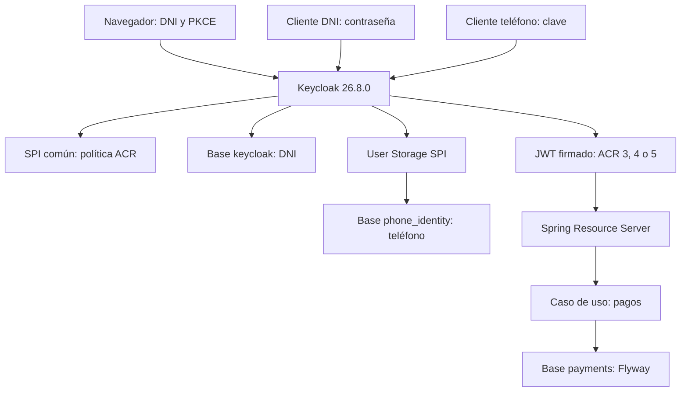

# Keycloak SPI y autorización ACR para procesamiento de pagos

Se implementa una PoC de identidad centrada en Keycloak: se extiende el servidor mediante un SPI común, tres módulos de autenticación y federación de usuarios mediante User Storage SPI. Se comprueba el origen de las credenciales, se establece el ACR en el servidor y se aplica autorización contextual en una API de pagos. El procesamiento de pagos permite observar el efecto de cada flujo; no se integra una red adquirente ni se procesan tarjetas reales.

## Caso de uso técnico

Se habilitan tres recorridos independientes en el realm `axiz`.

| Flujo | Cliente | Identificador | Origen de credenciales | ACR emitido | Operaciones permitidas |
| --- | --- | --- | --- | --- | --- |
| Authorization Code con PKCE S256 | `payments-web` | DNI de ocho dígitos | Base interna de Keycloak | `5` | Consultar, crear y aprobar pagos |
| Resource Owner Password / Direct Grant | `payments-password` | DNI de ocho dígitos | Base interna de Keycloak | `4` | Consultar y crear pagos |
| Login telefónico personalizado | `payments-phone` | Teléfono peruano en E.164 | Base PostgreSQL externa | `3` | Consultar pagos propios |

El login personalizado se integra como un flujo Direct Grant independiente, con cliente, Authenticator SPI y User Storage SPI propios. Se envía el teléfono en el parámetro OIDC `username` y la clave en `password`. Se conserva el endpoint estándar de emisión de tokens; no se construyen JWT ni se implementa un endpoint paralelo que omita las comprobaciones de Keycloak.

Los valores 3, 4 y 5 representan una clasificación interna solicitada para esta PoC. No equivalen a niveles NIST, eIDAS ni a autenticación multifactor. Authorization Code y ROPC utilizan el mismo factor de conocimiento. Se eleva el ACR por la política del recorrido, no porque el DNI aporte un factor adicional.

Se incluye ROPC para probar el requisito. La documentación vigente de Keycloak y RFC 9700 indican que este grant no debe utilizarse en nuevos sistemas productivos. Se conserva aislado en un cliente confidencial; Authorization Code con PKCE constituye el recorrido web recomendado.

## Caso funcional

Se permite registrar una orden de pago con monto y moneda, consultar las órdenes del usuario autenticado y aprobar una orden pendiente. Se verifica la firma del JWT, emisor, expiración, audiencia `payments-api`, rol `merchant` y ACR antes de ejecutar la operación. Se utilizan claves de idempotencia independientes por sujeto; una repetición conserva el identificador original y un cambio de contenido devuelve conflicto.

La identidad del propietario se obtiene de `sub`, no de parámetros del request. Se restringen las consultas y aprobaciones al mismo propietario. Se utiliza una actualización condicional para que una orden solo transicione de `PENDING` a `APPROVED` una vez.

## Tecnologías y compatibilidad

| Tecnología | Versión seleccionada | Uso |
| --- | --- | --- |
| Keycloak | 26.8.0 | Servidor OIDC y runtime de los SPI |
| Java de extensiones | Bytecode 21 | Compatibilidad con Java 21 de la imagen oficial de Keycloak |
| Java de pagos | 25 | Compilación y ejecución del servicio Spring |
| Spring Boot | 4.1.1 | Gestión consistente de dependencias y configuración |
| Spring Framework | 7.0.9, administrado por Boot | MVC, JDBC, validación e inyección |
| Spring Security | 7.1.1, administrado por Boot | Resource Server JWT y cliente OIDC con PKCE |
| Flyway | 12.4.0, administrado por Boot | Migración exclusiva del esquema de pagos |
| PostgreSQL | 18.6 | Persistencia de Keycloak, identidad externa y pagos |
| Maven | 3.10.0 en imagen de compilación | Reactor de cinco módulos y pruebas |
| Spotless / google-java-format | 3.10.4 / 1.36.1 | Formato reproducible de Java |
| kind / Kubernetes | 0.33.0 / 1.37.0 | Aprovisionamiento de un clúster local |
| Helm | 4.3.0 | Instalación y actualización del conjunto en Kubernetes |

Se utiliza google-java-format 1.36.1 como versión compatible verificada con Java 25 y Spotless. Se mantiene el BOM de Spring Boot para evitar mezclar versiones de Spring. Las extensiones se compilan contra las APIs exactas de Keycloak 26.8.0. El driver JDBC de las extensiones se declara `provided`: se utiliza el PostgreSQL JDBC 42.7.13 incluido en el servidor; no se copia un segundo driver al directorio `providers`. En el servicio de pagos se utiliza igualmente el driver administrado por Boot.

Se comparte una sola instancia PostgreSQL con tres bases separadas: `keycloak`, `phone_identity` y `payments`. No se agregan Kafka, cachés, bases vectoriales ni otros componentes que no intervengan en la autenticación.

## Arquitectura



En Kubernetes se despliegan PostgreSQL y Keycloak como StatefulSet, y pagos como Deployment. Se utiliza la distribución estable de Keycloak con un chart propio; no se instala un operador adicional para una PoC de un solo nodo. Las sondas de Keycloak utilizan el puerto de administración 9000, que no se expone al host. Se mantienen recursos limitados, persistencia PostgreSQL, ejecución sin privilegios en los servicios Java y carga de credenciales desde Secrets.

## Estructura del proyecto

```text
pom.xml
README.md
.env.example
spi-common/                 Política ACR, SPI propio y protocol mapper
spi-code/                   Verificación de DNI interno y ACR 5
spi-password/               Verificación de DNI interno y ACR 4
spi-phone/                  Verificación telefónica, federación y ACR 3
payment-service/            API hexagonal, portal OIDC y migración Flyway
datasets/                   Realm, esquema externo, datos y generador de hashes
infraestructura/            Compose, imágenes, aprovisionamiento y chart Helm
tests/                      Pruebas HTTP/OIDC y validación estática
dist/                       JAR compilados de los cinco módulos
verification/               Evidencia de validación del paquete
```

Se conservan muestras de request y response en `infraestructura/requests` e `infraestructura/responses`. Los identificadores de esas muestras son ilustrativos y no representan datos ya insertados. Toda la explicación se concentra en este archivo. Los archivos de configuración mantienen únicamente los comentarios necesarios en español.

## Código principal y decisiones de implementación

En `spi-common`, `AcrPolicySpi` declara el SPI `axiz-acr-policy`. `AcrPolicyProviderFactory` define su contrato de factory y `AcrPolicyFactory` registra el proveedor `default` mediante `META-INF/services`. Se guardan `axiz_acr` y `axiz_flow` como notas de sesión desde el contexto de autenticación validado.

`AcrMapper` publica `acr` y `auth_flow` en access token e ID token. Se obtiene el valor desde la sesión de Keycloak, no desde un atributo modificable del usuario ni desde `acr_values` enviado por el cliente. Se conserva el valor al renovar el token. Una sesión sin ACR verificado no puede emitir tokens con este mapper.

En `spi-code`, `CodeAuthenticator` se ejecuta después del formulario nativo de usuario y contraseña. Se exige DNI de ocho dígitos y ausencia de vínculo de federación. En `spi-password`, `PasswordAuthenticator` se ejecuta después de los validadores nativos de Direct Grant y aplica la misma restricción de origen. En `spi-phone`, `PhoneAuthenticator` exige teléfono E.164 y vínculo con almacenamiento federado. No se vuelve a comprobar una contraseña después de que el validador nativo haya terminado.

`PhoneStorage` implementa `UserLookupProvider` y `CredentialInputValidator` y `CredentialInputUpdater` de solo lectura. Se rechazan modificaciones de contraseña desde Keycloak. Se consultan identidades externas mediante JDBC, timeouts y sentencias preparadas; se utilizan conexiones de solo lectura lógico con un usuario que solo dispone de `SELECT`. No se importan identidades ni contraseñas a la tabla interna de usuarios. Se verifican hashes PBKDF2-HMAC-SHA256 de 256 bits, salt de 128 bits y 600 000 iteraciones mediante comparación de tiempo constante. Se desactiva la caché de usuarios externos para que la deshabilitación se consulte en la base. El dataset incluye un salt fijo únicamente para reproducir la demostración; el generador produce salts aleatorios.

Se mantiene el bloqueo por intentos fallidos en los validadores nativos, se deshabilitan registro libre, login por correo e implicit grant, y se activa rotación de refresh tokens. Se restringen los roles de cada cliente mediante scope mappings explícitos. El flujo web exige revalidar las credenciales en cada nuevo recorrido: se omite deliberadamente la ejecución Cookie para que una sesión de ACR 3 o 4 no permita obtener ACR 5 sin introducir el DNI y la contraseña.

En pagos, `domain` define `Payment` y el puerto `PaymentRepository`; `application` contiene `PaymentService`; `adapters` contiene JDBC, HTTP, autorización y configuración de seguridad. `SecurityConfiguration` separa la API JWT sin sesión del portal OIDC con sesión y protección CSRF. `AccessTokenPolicy` valida audiencia y correspondencia entre ACR y flujo; `AcrAuthorization` aplica el rol y el umbral ACR. `JdbcPaymentRepository` resuelve la concurrencia de idempotencia mediante la restricción única y `ON CONFLICT`, dentro de una transacción.

## Preparación en Fedora WSL

Se requiere WSL2, conexión a Internet, Docker Engine disponible para el usuario, Docker Compose v2 o posterior, Java 25, Maven, Python 3 y curl. Se ejecutan todos los comandos desde la raíz de este proyecto. Se comprueba que Docker pueda levantar contenedores antes de aprovisionar kind.

```bash
sudo dnf install -y java-25-openjdk-devel maven python3 curl tar gzip
java -version
mvn -version
docker version
docker compose version
cp .env.example .env
chmod 600 .env
```

Si el repositorio de Fedora no proporciona Java 25, se instala una distribución Temurin 25 y se configura `JAVA_HOME` para Maven. Para el modo de contenedores se utiliza el JDK de la imagen base y no se necesita Java en el host.

Los significados y valores admitidos de las propiedades se encuentran exclusivamente en `.env.example`. Se utiliza el archivo `.env` para las ejecuciones locales. El archivo no se incluye en el ZIP ni se incorpora a imágenes.

## Datos iniciales

Se precargan el usuario interno `12345678`, el rol `merchant`, tres clientes y los flujos de autenticación desde `datasets/axiz-realm.json`. Se resuelven los placeholders de credenciales mediante variables de entorno de Keycloak durante la importación.

Se precarga la identidad externa `+51987654321` con nombre, apellido y correo de demostración para satisfacer el perfil de usuario de Keycloak sin acciones interactivas pendientes. Esos atributos se consultan en la misma base externa; la autenticación utiliza únicamente teléfono y clave. La clave de demostración incluida en el dataset es `Telefono2026!`. Se puede sustituir antes del primer arranque:

```bash
bash datasets/generate.sh
```

Se ingresa la nueva clave sin mostrarla en terminal. Para ejecutar las pruebas con esa clave se actualiza el valor de demostración correspondiente en `.env`. El generador modifica el hash del dataset, no una base de datos ya inicializada.

`infraestructura/postgres-init.sh` crea bases y usuarios una sola vez y aplica `datasets/phone-seed.sql`. El esquema externo y su seed se mantienen en un único SQL. Flyway administra exclusivamente el esquema de pagos mediante `V1__payment.sql`; no se vuelve a crear ese esquema desde scripts de infraestructura. Keycloak administra su esquema con las migraciones internas del servidor.

La importación inicial no reemplaza un realm existente. Tampoco se vuelven a ejecutar los scripts de PostgreSQL cuando existe el volumen. Se realizan cambios posteriores mediante la consola o API administrativa y migraciones, según el componente; no se eliminan volúmenes automáticamente.

## Construcción y formato

Se puede importar el `pom.xml` raíz en IntelliJ IDEA, Eclipse o VS Code. Se selecciona JDK 25 para el reactor. Los SPI mantienen `release=21` y pagos `release=25`.

```bash
mvn -B -ntp verify spotless:check
```

Se genera `payment-service/target/payment-service-1.0.0-exec.jar` como artefacto ejecutable Spring Boot, separado del JAR normal de Maven. Se utiliza ese ejecutable en el host y en la imagen de pagos.

Se aplica el formato cuando se modifica código:

```bash
mvn -B -ntp spotless:apply
```

## Imagen base reutilizable

Se construye primero la imagen de compilación, que conserva Maven, JDK y dependencias del reactor. Se reutiliza en las imágenes finales mediante compilación offline. Se reconstruye únicamente cuando cambia el conjunto de dependencias o la versión del toolchain.

```bash
bash infraestructura/build-base.sh
```

La imagen final Keycloak incluye los cuatro JAR y ejecuta `kc.sh build` durante la construcción, no en cada arranque. Las imágenes de aplicación se conservan como `axiz/keycloak:1.0.0` y `axiz/payments:1.0.0`; un arranque con `--no-build` no recompila ni instala dependencias. Las imágenes finales no contienen Maven ni el repositorio de dependencias.

## Ejecución con infraestructura en Compose y servicio en host

Después de construir la base, se inicia PostgreSQL y Keycloak en una terminal:

```bash
docker compose --env-file .env -f infraestructura/docker-compose.yml up --build postgres keycloak
```

Se ejecuta el servicio de pagos en otra terminal:

```bash
bash infraestructura/run-host.sh
```

Se conservan los comandos en primer plano. Los puertos 5432, 8080 y 8090 deben estar libres. Si ya existe la imagen de Keycloak, se puede iniciar la infraestructura sin construir:

```bash
docker compose --env-file .env -f infraestructura/docker-compose.yml up --no-build postgres keycloak
```

## Ejecución completa con Compose

Se levanta infraestructura, importación, seed y servicio en un solo comando después de preparar `.env` y construir la imagen base:

```bash
docker compose --env-file .env -f infraestructura/docker-compose.yml --profile app up --build
```

Para reutilizar las imágenes existentes:

```bash
docker compose --env-file .env -f infraestructura/docker-compose.yml --profile app up --no-build
```

El servicio auxiliar `routes` espera la disponibilidad de Keycloak y pagos e imprime las rutas. Termina con código cero y no procesa peticiones. Se deja PostgreSQL persistido al detener Compose.

## Aprovisionamiento y despliegue completo en Kubernetes

Se incluyen los binarios de instalación mediante un script para Linux AMD64 o ARM64. Se descargan en `.tools`, sin reemplazar herramientas globales. Se provisiona un clúster kind llamado `axiz`, se construyen las imágenes, se cargan en sus nodos y se instala el chart Helm.

```bash
bash infraestructura/deploy-k8s.sh --build
```

Para reutilizar las imágenes:

```bash
bash infraestructura/deploy-k8s.sh --no-build
```

Se aplica el namespace `axiz`, se espera la disponibilidad de los workloads y se imprimen las rutas. Se utiliza `--wait` con timeout de quince minutos. Los valores de Secrets se generan desde `.env` en `.runtime` con permisos restringidos. Se evita suministrar contraseñas como argumentos del proceso Helm.

Se recomienda asignar al entorno WSL al menos cuatro CPU y 8 GiB de memoria. No se ejecutan Compose y kind simultáneamente porque ambos utilizan 8080 y 8090. Para pasar de Compose a Kubernetes se detienen primero los servicios:

```bash
docker compose --env-file .env -f infraestructura/docker-compose.yml --profile app down
```

Se consulta el despliegue:

```bash
.tools/kubectl -n axiz get pods,services,pvc
.tools/helm status axiz -n axiz
.tools/kubectl -n axiz logs statefulset/keycloak --tail=80
.tools/kubectl -n axiz logs deployment/payments --tail=80
```

Para un clúster local vacío se conserva la importación y seed inicial. Un `helm upgrade` no sustituye automáticamente el realm persistido. El chart monta un único PostgreSQL persistente y una réplica Keycloak; no representa una topología de alta disponibilidad. La distribución estable se despliega sin `start-dev`, con imagen optimizada. HTTP y NodePort se limitan al laboratorio local mediante bindings de kind en `127.0.0.1`. Para publicar el entorno se incorporan TLS, hostname público, ingress y gestión externa de secretos, y se cambia `sslRequired` del realm. No se considera el laboratorio una configuración productiva completa.

## Endpoints en orden de ejecución

| Método | Ruta | Descripción funcional | Descripción técnica |
| --- | --- | --- | --- |
| GET | `:8080/realms/axiz/.well-known/openid-configuration` | Descubrir el proveedor de identidad | Metadata OIDC; permite comprobar importación |
| GET | `:8090/` | Abrir el portal de demostración | Inicio público del cliente web |
| GET | `:8090/oauth2/authorization/axiz` | Iniciar sesión con DNI | Spring genera state, nonce y PKCE S256 |
| GET | `:8080/realms/axiz/protocol/openid-connect/auth` | Presentar formulario Keycloak | Authorization Code para `payments-web` |
| GET | `:8090/login/oauth2/code/axiz` | Completar la sesión web | Callback validado por Spring; intercambio de código |
| GET | `:8090/portal` | Consultar identidad de sesión | Se devuelve username, ACR y flujo sin exponer tokens |
| POST | `:8080/realms/axiz/protocol/openid-connect/token` | Obtener o renovar tokens | Código+PKCE, Direct Grant DNI/teléfono y refresh |
| GET | `:8080/realms/axiz/protocol/openid-connect/certs` | Consultar claves públicas | JWKS para validar firma JWT |
| GET | `:8090/api/identity` | Consultar identidad del access token | JWT válido con audiencia `payments-api` |
| GET | `:8090/api/payments` | Consultar pagos propios | `merchant`, ACR mínimo 3 y filtro por `sub` |
| POST | `:8090/api/payments` | Registrar una orden de pago | `merchant`, ACR mínimo 4 e idempotencia |
| POST | `:8090/api/payments/{id}/approve` | Aprobar una orden pendiente | `merchant`, ACR mínimo 5 y propietario |
| GET | `:8080/realms/axiz/protocol/openid-connect/userinfo` | Consultar perfil OIDC | Access token y scope `openid` |
| POST | `:8080/realms/axiz/protocol/openid-connect/revoke` | Revocar credenciales de sesión | Endpoint estándar con autenticación de cliente |
| GET/POST | `:8080/realms/axiz/protocol/openid-connect/logout` | Terminar sesión | Logout OIDC; se aplican parámetros estándar |
| GET | `:8090/ready` | Comprobar proceso de pagos disponible | Sonda HTTP sin autenticación |
| GET | `:8080/admin/` | Administrar realm, usuarios y clientes | Consola administrativa; cuenta bootstrap separada |

La ruta `http://localhost:8090/callback-test` está registrada únicamente para que la prueba automatizada capture la redirección OIDC sin añadir un controlador que exponga códigos. El script intercepta la redirección y no navega a esa ruta.

## Pruebas manuales mediante curl

Se cargan las propiedades en la terminal desde la raíz:

```bash
set -a
source .env
set +a
TOKEN_URL="$KEYCLOAK_PUBLIC_URL/realms/axiz/protocol/openid-connect/token"
```

### Descubrimiento del realm

Se confirma que Keycloak está disponible y que el realm se ha importado:

```bash
curl -fsS "$KEYCLOAK_PUBLIC_URL/realms/axiz/.well-known/openid-configuration" | python3 -m json.tool
```

Se obtiene metadata JSON con `issuer`, `authorization_endpoint`, `token_endpoint` y `jwks_uri`.

### DNI mediante Resource Owner Password

Se valida el usuario interno y se obtiene un token con ACR 4:

```bash
DNI_RESPONSE=$(curl -fsS -X POST "$TOKEN_URL" \
  --data-urlencode 'grant_type=password' \
  --data-urlencode 'client_id=payments-password' \
  --data-urlencode "client_secret=$PASSWORD_CLIENT_SECRET" \
  --data-urlencode 'username=12345678' \
  --data-urlencode "password=$DNI_PASSWORD" \
  --data-urlencode 'scope=openid')
DNI_TOKEN=$(printf '%s' "$DNI_RESPONSE" | python3 -c 'import json,sys; print(json.load(sys.stdin)["access_token"])')
curl -fsS -H "Authorization: Bearer $DNI_TOKEN" http://localhost:8090/api/identity
```

Respuesta de identidad, con `subject` variable:

```json
{"subject":"identificador-interno","acr":"4","flow":"password"}
```

La respuesta de token incluye `access_token`, `refresh_token`, `id_token`, `expires_in` y `token_type`. No se imprimen los tokens en los logs del servicio.

### Teléfono mediante almacenamiento externo

Se consulta la base externa, se verifica el hash y se obtiene ACR 3. Se utiliza `--data-urlencode` para conservar el signo `+` del teléfono:

```bash
PHONE_RESPONSE=$(curl -fsS -X POST "$TOKEN_URL" \
  --data-urlencode 'grant_type=password' \
  --data-urlencode 'client_id=payments-phone' \
  --data-urlencode "client_secret=$PHONE_CLIENT_SECRET" \
  --data-urlencode 'username=+51987654321' \
  --data-urlencode "password=$PHONE_DEMO_PASSWORD" \
  --data-urlencode 'scope=openid')
PHONE_TOKEN=$(printf '%s' "$PHONE_RESPONSE" | python3 -c 'import json,sys; print(json.load(sys.stdin)["access_token"])')
curl -fsS -H "Authorization: Bearer $PHONE_TOKEN" http://localhost:8090/api/identity
curl -fsS -H "Authorization: Bearer $PHONE_TOKEN" http://localhost:8090/api/payments
```

Se devuelve `{"subject":"f:componente:telefono","acr":"3","flow":"phone"}` y una lista vacía si todavía no existen pagos propios.

### Rechazo de una creación con ACR 3

Se verifica la autorización funcional, aun cuando la autenticación haya sido válida:

```bash
curl -sS -o /dev/null -w 'HTTP %{http_code}\n' \
  -H "Authorization: Bearer $PHONE_TOKEN" \
  -H 'Content-Type: application/json' \
  -H 'Idempotency-Key: phone-denied-2026' \
  -d '{"amount":100.50,"currency":"PEN"}' \
  http://localhost:8090/api/payments
```

Se espera HTTP 403 y no se registra ningún pago.

### Creación e idempotencia con ACR 4

Se registra una orden pendiente con el DNI:

```bash
PAYMENT_RESPONSE=$(curl -fsS \
  -H "Authorization: Bearer $DNI_TOKEN" \
  -H 'Content-Type: application/json' \
  -H 'Idempotency-Key: dni-payment-2026' \
  -d '{"amount":100.50,"currency":"PEN"}' \
  http://localhost:8090/api/payments)
printf '%s\n' "$PAYMENT_RESPONSE"
PAYMENT_ID=$(printf '%s' "$PAYMENT_RESPONSE" | python3 -c 'import json,sys; print(json.load(sys.stdin)["id"])')
```

Respuesta HTTP 200:

```json
{"id":"uuid","owner":"identificador-interno","amount":100.50,"currency":"PEN","status":"PENDING"}
```

Se repite exactamente el mismo request para comprobar que se devuelve el mismo `id`. Se modifica el monto conservando la clave para comprobar HTTP 409 con `{"error":"La clave de idempotencia ya contiene otro pago"}`.

### Rechazo de aprobación con ACR 4

```bash
curl -sS -o /dev/null -w 'HTTP %{http_code}\n' -X POST \
  -H "Authorization: Bearer $DNI_TOKEN" \
  "http://localhost:8090/api/payments/$PAYMENT_ID/approve"
```

Se espera HTTP 403. Se mantiene la orden pendiente.

### Authorization Code con PKCE y ACR 5

Se abre `http://localhost:8090/`, se selecciona el enlace de inicio y se autentica el DNI `12345678` con la clave configurada. Se consulta `http://localhost:8090/portal` después de completar el login. Se obtiene `{"username":"12345678","acr":"5","flow":"code"}`.

La secuencia OIDC completa, incluida la aprobación con su access token, se automatiza en `tests/e2e.py`. Para un intercambio manual se requiere obtener primero un código mediante el navegador con state, nonce y un `code_challenge` S256; el código queda ligado al redirect URI y al verificador original. No se utiliza un grant de contraseña para simular Authorization Code.

El request de intercambio por curl, con las variables obtenidas durante ese recorrido, es:

```bash
curl -fsS -X POST "$TOKEN_URL" \
  --data-urlencode 'grant_type=authorization_code' \
  --data-urlencode 'client_id=payments-web' \
  --data-urlencode 'redirect_uri=http://localhost:8090/callback-test' \
  --data-urlencode "code=$AUTHORIZATION_CODE" \
  --data-urlencode "code_verifier=$PKCE_VERIFIER"
```

Se obtiene un access token con `acr=5`. El código solo admite un intercambio. Se utiliza ese token como `CODE_TOKEN` para aprobar el pago del mismo DNI:

```bash
curl -fsS -X POST -H "Authorization: Bearer $CODE_TOKEN" \
  "http://localhost:8090/api/payments/$PAYMENT_ID/approve"
```

Se devuelve HTTP 200 con `{"status":"APPROVED"}`. Una segunda aprobación devuelve 404 porque ya no existe una orden pendiente que cumpla la condición.

### Renovación y persistencia de ACR

```bash
REFRESH_TOKEN=$(printf '%s' "$DNI_RESPONSE" | python3 -c 'import json,sys; print(json.load(sys.stdin)["refresh_token"])')
curl -fsS -X POST "$TOKEN_URL" \
  --data-urlencode 'grant_type=refresh_token' \
  --data-urlencode 'client_id=payments-password' \
  --data-urlencode "client_secret=$PASSWORD_CLIENT_SECRET" \
  --data-urlencode "refresh_token=$REFRESH_TOKEN"
```

Se obtiene un nuevo par de tokens y se mantiene ACR 4. Se utiliza el nuevo refresh token para futuras renovaciones. La reutilización del anterior se rechaza con HTTP 400. La revocación de un refresh token no invalida instantáneamente un access token validado offline; este último mantiene su validez hasta expirar.

### Credenciales incorrectas y separación de flujos

Se repite el request de DNI con una contraseña incorrecta; se espera `invalid_grant` y HTTP 400. Se envía el teléfono y su clave al cliente `payments-password`, o el DNI al cliente `payments-phone`; se espera igualmente rechazo. Se envía `acr_values=5` al cliente de DNI directo o teléfono; no se eleva el ACR establecido por el SPI.

## Ejecución de todo el conjunto de pruebas

Con los servicios disponibles y Java 25 en el host:

```bash
bash tests/run-all.sh
```

Se ejecutan compilación, pruebas unitarias, verificación de formato y pruebas HTTP reales. Se valida discovery, credenciales incorrectas, separación de orígenes, los tres ACR, PKCE, state, nonce, callback y sesión del portal, rechazo de reutilización de código, autorización 401/403, creación, idempotencia, conflicto de contenido, aprobación, aislamiento por usuario, rechazo de JWT alterado y rotación de refresh tokens. En el laboratorio HTTP se reproduce el tratamiento de cookies Secure de localhost de los navegadores únicamente dentro del cliente de pruebas; fuera de localhost se mantiene su restricción HTTPS. Se guarda el resultado sin tokens ni contraseñas en `.runtime/e2e-results.json`.

Se realiza validación estática de scripts, Compose y Helm:

```bash
bash tests/validate-static.sh
```

Para repetir las pruebas de idempotencia se genera una clave aleatoria por ejecución. Las pruebas no eliminan usuarios ni bases y dejan una orden aprobada de demostración. La prueba de aislamiento telefónico presupone que el dataset externo no contiene órdenes previas; no se utiliza ese usuario para crear pagos porque su ACR no lo permite.

## Operación y resolución de problemas

Los health checks PostgreSQL son silenciosos (`pg_isready -q`). Las sondas HTTP no habilitan access logs ni producen una línea de log por petición. Se conservan los eventos de autenticación y los fallos del servidor; no se suprimen errores para ocultar una configuración incorrecta.

Si se obtiene `invalid_client`, se comprueba que el secreto de `.env` coincide con el cliente ya importado. Cambiar `.env` después de la importación no actualiza automáticamente el cliente persistido. Si se obtiene `invalid_grant`, se comprueba la clave, el tipo de identificador y el cliente seleccionado. Tras varios fallos consecutivos se espera el bloqueo temporal configurado antes de volver a probar.

Si se utiliza un token con emisor distinto de la URL pública, se obtiene 401. Se mantiene `http://localhost:8080` como hostname público tanto en Compose como en kind. La URL interna se utiliza para alcanzar el token endpoint y JWKS dentro de la red; no reemplaza el emisor público del JWT. No se inicia Compose mientras kind mantiene sus puertos publicados.

Si Helm espera indefinidamente, se inspeccionan `pods`, `describe pod` y los logs. Se comprueba que las imágenes se hayan cargado con kind, que Docker tenga memoria suficiente y que exista almacenamiento persistente. Si cambia una dependencia, se reconstruye la base antes de compilar offline las imágenes de aplicación.

Los autenticadores y protocol mappers utilizan APIs que Keycloak clasifica como SPI internos. Se fija la versión del servidor y se recompila y ejecuta el conjunto de pruebas antes de actualizarlo. Las advertencias de clasificación SPI no indican por sí solas un fallo del proveedor.

## Evidencia y alcance de validación

Se adjunta evidencia de compilación y pruebas en `verification`. Se diferencia la validación ejecutada de las pruebas incluidas para ejecutar en Fedora WSL. La compilación y el formato se verifican con Java 25 contra las dependencias reales seleccionadas; no se reemplazan los SPI por implementaciones simuladas.

La ejecución Docker y el despliegue Kubernetes requieren un Docker Engine que no está disponible en el entorno de generación. Se incluyen los comandos, scripts y chart, pero no se presenta su despliegue como una comprobación ya realizada. Se ejecutaron los tres flujos contra un servidor real Keycloak con persistencia interna H2 de laboratorio. El flujo telefónico utilizó un fixture H2 externo adaptado al protocolo PostgreSQL, con JDBC real y el proveedor sin cambios; esa prueba no sustituye la validación de PostgreSQL 18 ni de sus privilegios. Se verificaron también el callback del portal Spring, los tres roles y ACR en la API, rechazo 401/403 y conservación de ACR al renovar. Para esas pruebas de identidad se deshabilitó Flyway únicamente en el proceso de verificación, porque no estaba disponible la instancia PostgreSQL de pagos. La configuración entregada conserva Flyway habilitado.

La persistencia de pagos, las migraciones y el conjunto completo de idempotencia/aprobación permanecen pendientes de ejecución sobre PostgreSQL 18. 

Los JAR verificados se incluyen en `dist`; las construcciones Docker generan sus propios JAR desde el código fuente. El resultado exacto de las comprobaciones adicionales se registra en `verification/summary.json`.

## Referencias técnicas

- Keycloak, distribución y versión: https://www.keycloak.org/downloads
- Keycloak, Authentication SPI, SPI propio y User Storage SPI: https://www.keycloak.org/docs/latest/server_development/index.html
- Keycloak, grants OIDC y limitaciones de ROPC: https://www.keycloak.org/securing-apps/oidc-layers
- Keycloak, imagen optimizada: https://www.keycloak.org/server/containers
- Spring Boot 4.1.1: https://spring.io/blog/2026/08/20/spring-boot-4-1-1-available-now
- OAuth 2.0 Security Best Current Practice: https://www.rfc-editor.org/rfc/rfc9700
- PostgreSQL 18.6: https://www.postgresql.org/docs/release/18.6/
- kind: https://kind.sigs.k8s.io/docs/user/quick-start/
- Helm: https://helm.sh/docs/
