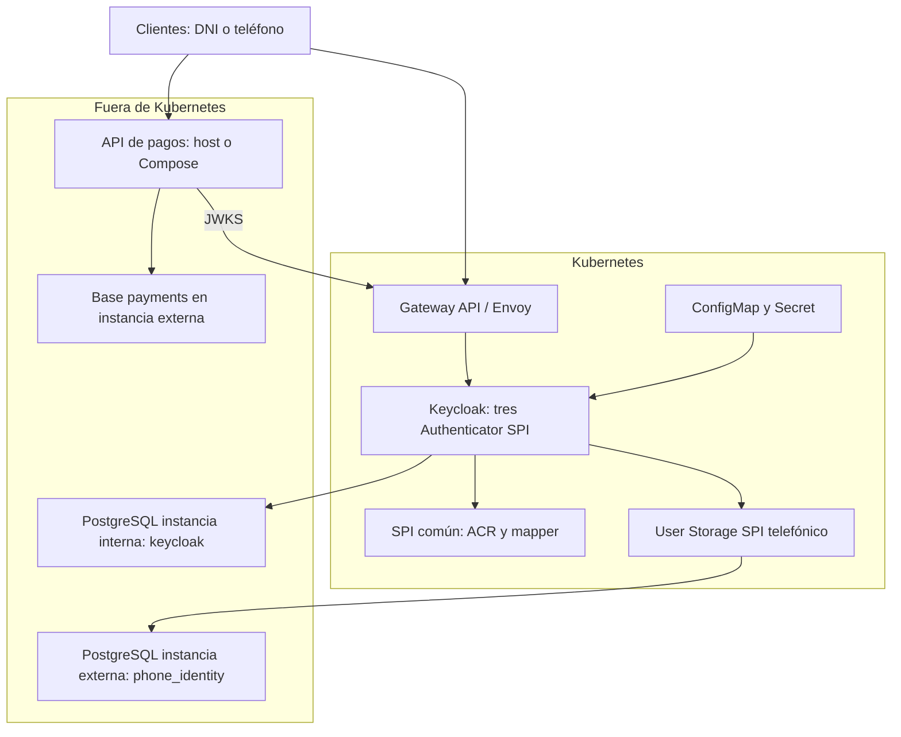

# Keycloak SPI y autorización ACR para procesamiento de pagos

Se implementa una PoC de identidad centrada en Keycloak: se extiende el servidor mediante un SPI común, tres módulos de autenticación y federación de usuarios mediante User Storage SPI. Se autentica con identificador y contraseña en cada flujo, se establece el ACR en el servidor y se aplica autorización contextual en una API de pagos. El procesamiento de pagos permite observar el efecto de cada flujo; no se integra una red adquirente ni se procesan tarjetas reales.

## Caso de uso técnico

Se habilitan tres recorridos independientes en el realm `axiz`.

| Flujo | Cliente | Identificador | Origen de credenciales | ACR emitido | Operaciones permitidas |
| --- | --- | --- | --- | --- | --- |
| Authorization Code con PKCE S256 | `payments-web` | DNI de ocho dígitos | Base interna de Keycloak | `5` | Consultar, crear y aprobar pagos |
| Resource Owner Password / Direct Grant | `payments-password` | DNI de ocho dígitos | Base interna de Keycloak | `4` | Consultar y crear pagos |
| Login telefónico personalizado | `payments-phone` | Teléfono peruano en E.164 | Base PostgreSQL externa | `3` | Consultar pagos propios |

El login personalizado se integra como un flujo Direct Grant independiente, con cliente, Authenticator SPI y User Storage SPI propios. Se envía el teléfono en el parámetro OIDC `username` y la clave en `password`. Se conserva el endpoint estándar de emisión de tokens; no se construyen JWT ni se implementa un endpoint paralelo que omita las comprobaciones de Keycloak.

Los valores 3, 4 y 5 representan una clasificación interna solicitada para esta PoC. No equivalen a niveles NIST, eIDAS ni a autenticación multifactor. Authorization Code y ROPC utilizan el mismo factor de conocimiento. Se eleva el ACR por la política del recorrido, no porque el DNI aporte un factor adicional.

Se incluye ROPC para probar el requisito. La documentación vigente de Keycloak y RFC 9700 indican que este grant no debe utilizarse en nuevos sistemas productivos. Se conserva aislado en un cliente confidencial; Authorization Code con PKCE constituye el recorrido web recomendado.

## Caso funcional

Se permite registrar una orden de pago con monto y moneda, consultar las órdenes del usuario autenticado y aprobar una orden pendiente. Se verifica la firma del JWT, emisor, expiración, audiencia `payments-api`, rol `merchant` y ACR antes de ejecutar la operación. Se utilizan claves de idempotencia independientes por sujeto; una repetición conserva el identificador original y un cambio de contenido devuelve conflicto.

La identidad del propietario se obtiene de `sub`, no de parámetros del request. Se restringen las consultas y aprobaciones al mismo propietario. Se utiliza una actualización condicional para que una orden solo transicione de `PENDING` a `APPROVED` una vez.

## Tecnologías y compatibilidad

| Tecnología | Versión seleccionada | Uso |
| --- | --- | --- |
| Keycloak | 26.8.0 | Servidor OIDC y runtime de los SPI |
| Java de extensiones | Bytecode 21 | Compatibilidad con Java 21 de la imagen oficial de Keycloak |
| Java de pagos | 25 | Compilación y ejecución del servicio Spring |
| Spring Boot | 4.1.1 | Gestión consistente de dependencias y configuración |
| Spring Framework | 7.0.9, administrado por Boot | MVC, JDBC, validación e inyección |
| Spring Security | 7.1.1, administrado por Boot | Resource Server JWT y cliente OIDC con PKCE |
| Flyway | 12.4.0, administrado por Boot | Migración exclusiva del esquema de pagos |
| PostgreSQL | 18.6 | Persistencia de Keycloak, identidad externa y pagos |
| Maven | 3.10.0 en imagen de compilación | Reactor de cinco módulos y pruebas |
| Spotless / google-java-format | 3.10.4 / 1.36.1 | Formato reproducible de Java |
| kind / Kubernetes | 0.33.0 / 1.36.4 | Aprovisionamiento de un clúster local |
| Helm | 4.3.0 | Instalación y actualización de Keycloak en Kubernetes |
| Python | 3.14.8 en el contenedor de carga | Admin REST con librería estándar, sin dependencias adicionales |
| Envoy Gateway / Gateway API | 1.9.2 / 1.6.1 | Controlador y proxy de exposición HTTP mediante Gateway y HTTPRoute |

Se utiliza google-java-format 1.36.1 como versión compatible verificada con Java 25 y Spotless. Se mantiene el BOM de Spring Boot para evitar mezclar versiones de Spring. Las extensiones se compilan contra las APIs exactas de Keycloak 26.8.0. El driver JDBC de las extensiones se declara `provided`: se utiliza el PostgreSQL JDBC 42.7.13 incluido en el servidor; no se copia un segundo driver al directorio `providers`. En el servicio de pagos se utiliza igualmente el driver administrado por Boot.

Se utilizan dos instancias PostgreSQL independientes: `postgres-keycloak` mantiene exclusivamente la base `keycloak`; `postgres-external` mantiene `phone_identity` y una base separada `payments`. Cada instancia dispone de proceso, contraseña administrativa, volumen y puerto propios. Ambas se ejecutan fuera de Kubernetes mediante Compose. No se comparte la instancia de Keycloak con el almacenamiento externo. No se agregan Kafka, cachés, bases vectoriales ni otros componentes que no intervengan en la autenticación.

## Arquitectura



En Kubernetes se despliega una réplica de la distribución estable Keycloak, con imagen optimizada y chart propio. Se instalan Envoy Gateway y las CRD de Gateway API mediante el chart oficial; GatewayClass, EnvoyProxy, Gateway y HTTPRoute exponen el servicio ClusterIP de Keycloak. Se utiliza la rama estable compatible con Kubernetes 1.36. No se crean workloads, PVC ni Jobs PostgreSQL dentro del clúster. La API de pagos se ejecuta en el host o en Compose.

Las sondas de Keycloak utilizan el puerto administrativo 9000, sin ruta pública. Se utiliza ejecución sin privilegios, límites de CPU/memoria, ConfigMap para el realm y Secret para credenciales. Las sondas y access logs HTTP no generan mensajes periódicos de health check. En kind se conectan los contenedores PostgreSQL externos a la red Docker del clúster para que los pods alcancen sus direcciones privadas; su ciclo de vida sigue siendo externo a Kubernetes.

## Estructura del proyecto

```text
pom.xml                     Reactor Maven de cinco módulos
README.md                   Documentación completa de la PoC
.env.example                Configuración de ejemplo
common-spi/                 Política ACR, SPI propio y protocol mapper
auth-code-dni-spi/           Autenticación web DNI y clave, ACR 5
ropc-dni-spi/                Autenticación Direct Grant DNI y clave, ACR 4
external-auth-phone-spi/     Autenticación teléfono y clave, User Storage y ACR 3
payment-service/            API hexagonal, portal OIDC y migración Flyway
infrastructure/             Compose, imágenes, aprovisionamiento y chart Helm
  datasets/                 Realm, SQL externo y generador de hashes
    postman/                Colección de pruebas y entorno importable
tests/                      Pruebas HTTP/OIDC y validación estática
dist/                       JAR compilados de los cinco módulos
verification/               Evidencia de validación del paquete
```

Se conservan muestras de request y response en `infrastructure/requests` e `infrastructure/responses`. Los identificadores de esas muestras son ilustrativos y no representan datos ya insertados. Toda la explicación se concentra en este archivo. Los archivos de configuración mantienen únicamente los comentarios necesarios en español.

## Código principal y decisiones de implementación

Se utiliza el sufijo `-spi` en los cuatro módulos: `common-spi`, `auth-code-dni-spi`, `ropc-dni-spi` y `external-auth-phone-spi`. Los IDs registrados en Keycloak y los paquetes Java se conservan estables.

En `common-spi`, `AcrPolicySpi` declara el SPI `axiz-acr-policy`. `AcrPolicyProviderFactory` define su contrato de factory y `AcrPolicyFactory` registra el proveedor `default` mediante `META-INF/services`. Se guardan `axiz_acr` y `axiz_flow` como notas de sesión desde el contexto de autenticación validado.

`AcrMapper` publica `acr` y `auth_flow` en access token e ID token. Se obtiene el valor desde la sesión de Keycloak, no desde un atributo modificable del usuario ni desde `acr_values` enviado por el cliente. Se conserva el valor al renovar el token. Una sesión sin ACR verificado no puede emitir tokens con este mapper.

En `auth-code-dni-spi`, `AuthCodeDniAuthenticator` extiende `UsernamePasswordForm`: se muestra el formulario de Keycloak, se comprueba el DNI y el origen interno, y se autentica la contraseña con el gestor nativo de credenciales. Se conservan el manejo del formulario, los eventos y la protección contra fuerza bruta del servidor. Se establece ACR 5 únicamente después de autenticar correctamente.

En `ropc-dni-spi`, `RopcDniAuthenticator` realiza la resolución del usuario interno por DNI y la comprobación de contraseña en una sola ejecución. En `external-auth-phone-spi`, `ExternalAuthPhoneAuthenticator` resuelve el teléfono mediante el componente `external-auth-phone-storage` y autentica la contraseña mediante `credentialManager().isValid`, que delega en `PhoneStorage`. Se utiliza `CredentialGrantAuthenticator` como implementación compartida del procesamiento de credenciales, estados de usuario, bloqueo por fuerza bruta, errores OAuth y eventos. Se registra `PASSWORD_VALIDATED` y el tipo de credencial password al completar la autenticación. No se agregan ejecuciones separadas de `direct-grant-validate-username` o `direct-grant-validate-password` a estos flujos.

Cada factory implementa `ServerInfoAwareProviderFactory`. Se genera `Implementation-Version` desde `${project.version}` en el manifiesto de cada JAR durante el build y se publica en la información operativa de Keycloak. Se lee la versión del JAR de cada factory, de modo que una mezcla accidental de versiones no quede oculta por la versión del módulo común. En **Server info → Provider info** se consulta `version=1.1.0` para los tres autenticadores, el proveedor común y User Storage. En **Authentication → Flows → Add execution** se visualizan los nombres `Authorization Code DNI / v1.1.0 / ACR 5`, `ROPC DNI / v1.1.0 / ACR 4` y `External Auth teléfono / v1.1.0 / ACR 3`. Los IDs permanecen estables al cambiar una versión, de modo que no se rompan los bindings del realm.

`PhoneStorage` implementa `UserLookupProvider` y `CredentialInputValidator` y `CredentialInputUpdater` de solo lectura. Se rechazan modificaciones de contraseña desde Keycloak. Se consultan identidades externas mediante JDBC, timeouts y sentencias preparadas; se utilizan conexiones de solo lectura lógico con un usuario que solo dispone de `SELECT`. No se importan identidades ni contraseñas a la tabla interna de usuarios. Se verifican hashes PBKDF2-HMAC-SHA256 de 256 bits, salt de 128 bits y 600 000 iteraciones mediante comparación de tiempo constante. Se desactiva la caché de usuarios externos para que la deshabilitación se consulte en la base. El dataset incluye salts diferentes por usuario; el generador permite regenerarlos con una clave nueva.

Se mantiene el bloqueo por intentos fallidos mediante los servicios nativos de protección contra fuerza bruta, se deshabilitan registro libre, login por correo e implicit grant, y se activa rotación de refresh tokens. Se restringen los roles de cada cliente mediante scope mappings explícitos. El flujo web exige revalidar las credenciales en cada nuevo recorrido: se omite deliberadamente la ejecución Cookie para que una sesión de ACR 3 o 4 no permita obtener ACR 5 sin introducir el DNI y la contraseña.

En pagos, `domain` define `Payment` y el puerto `PaymentRepository`; `application` contiene `PaymentService`; `adapters` contiene JDBC, HTTP, autorización y configuración de seguridad. `SecurityConfiguration` separa la API JWT sin sesión del portal OIDC con sesión y protección CSRF. `AccessTokenPolicy` valida audiencia y correspondencia entre ACR y flujo; `AcrAuthorization` aplica el rol y el umbral ACR. `JdbcPaymentRepository` resuelve la concurrencia de idempotencia mediante la restricción única y `ON CONFLICT`, dentro de una transacción.

## Preparación en Fedora WSL

Se requiere WSL2, conexión a Internet, Docker Engine disponible para el usuario, Docker Compose 2.22 o posterior con BuildKit y el plugin Buildx (se ha validado la configuración con Compose 5.6.0), Java 25, Maven, Python 3 y curl. Se ejecutan todos los comandos desde la raíz de este proyecto. Se comprueba que Docker pueda levantar contenedores antes de aprovisionar kind.

```bash
sudo dnf install -y java-25-openjdk-devel maven python3 curl tar gzip
java -version
mvn -version
docker version
docker compose version
cp .env.example .env
chmod 600 .env
```

Si el repositorio de Fedora no proporciona Java 25, se instala una distribución Temurin 25 y se configura `JAVA_HOME` para Maven. Para el modo de contenedores se utiliza el JDK de la imagen base y no se necesita Java en el host.

Los significados y valores admitidos de las propiedades se encuentran exclusivamente en `.env.example`. Se utiliza el archivo `.env` para las ejecuciones locales. El archivo no se incluye en el ZIP ni se incorpora a imágenes.

## Datos iniciales

Se importan el rol `merchant`, tres clientes, los bindings y los flujos desde `infrastructure/datasets/axiz-realm.json`. Se resuelven los secretos de clientes durante la importación de Keycloak. Los usuarios internos se generan mediante `infrastructure/seed-keycloak.sh` y su implementación Admin REST `seed-keycloak.py`, con operaciones idempotentes de creación, actualización de perfil, asignación de contraseña y rol.

| Origen | Identificadores de prueba | Estado | Uso |
| --- | --- | --- | --- |
| Keycloak interno | `12345678`, `87654321`, `11223344` | Habilitados | DNI + clave en Authorization Code o ROPC |
| Keycloak interno | `22334455` | Deshabilitado | Rechazo de autenticación |
| Instancia externa | `+51987654321`, `+51912345678` | Habilitados | Teléfono + clave en flujo externo |
| Instancia externa | `+51911111111` | Deshabilitado | Rechazo de autenticación externa |

Se incluyen nombre, apellido y correo sintéticos para satisfacer el perfil de Keycloak sin acciones interactivas pendientes. Las identidades telefónicas se consultan en la base externa y no se importan como usuarios internos; su clave inicial es `Telefono2026!`. Para regenerar los hashes antes del primer arranque:

```bash
bash infrastructure/datasets/generate.sh
```

Se ingresa la nueva clave sin mostrarla en terminal y se actualiza su valor de demostración en `.env`. Se generan salts independientes para cada fila. El generador modifica el dataset y no una base ya inicializada.

`infrastructure/postgres-keycloak-init.sh` inicializa exclusivamente el rol y la base de Keycloak en la primera instancia. `infrastructure/postgres-external-init.sh` inicializa roles, base telefónica y base de pagos en la segunda instancia y aplica `infrastructure/datasets/phone-seed.sql`. Flyway administra exclusivamente el esquema de pagos mediante `V1__payment.sql`; Keycloak administra su esquema mediante sus propias migraciones. No se duplica la creación de esquemas.

Compose ejecuta el servicio de carga `seed-keycloak` tras el arranque del realm; el despliegue Kubernetes ejecuta el mismo script desde el host una vez que el Gateway está disponible. Para volver a cargar los usuarios sintéticos:

```bash
bash infrastructure/seed-keycloak.sh
```

Se restablecen las contraseñas, los perfiles y los estados de esos usuarios de demostración. Se imprime cada DNI aprovisionado y las versiones de los proveedores, sin imprimir contraseñas ni tokens. El script espera la disponibilidad del realm durante un máximo de cuatro minutos. La importación no reemplaza un realm existente y los scripts PostgreSQL solo se ejecutan al inicializar un volumen vacío.

## Construcción y formato

Se puede importar el `pom.xml` raíz en IntelliJ IDEA, Eclipse o VS Code. Se selecciona JDK 25 para el reactor. Los SPI mantienen `release=21` y pagos `release=25`.

```bash
mvn -B -ntp verify spotless:check
```

Se genera `payment-service/target/payment-service-1.1.0-exec.jar` como artefacto ejecutable Spring Boot, separado del JAR normal de Maven. Se utiliza ese ejecutable en el host y en la imagen de pagos.

Se aplica el formato cuando se modifica código:

```bash
mvn -B -ntp spotless:apply
```

## Imagen base reutilizable

Compose construye primero `axiz/java-build-base:1.1.0` mediante `additional_contexts`, antes de compilar Keycloak y pagos. Se declara la dependencia de build explícitamente para evitar que Docker intente descargar la imagen privada de Docker Hub. El servicio de construcción tiene el perfil `build`: se incluye en el grafo de build como dependencia, pero no se inicia como contenedor al levantar el perfil `app`. No se requiere activar ese perfil ni ejecutar una construcción manual antes del primer arranque.

La imagen base conserva Maven, JDK y dependencias del reactor. Solo se copian los POM para prepararla; los cambios en código no invalidan esa capa. Se reutiliza la caché de BuildKit y las aplicaciones se compilan offline. Los cambios en POM o en el toolchain actualizan automáticamente la base al ejecutar `up --build`. Se puede preparar la imagen por separado de forma opcional:

```bash
bash infrastructure/build-base.sh
```

La imagen final Keycloak incluye los cuatro JAR y ejecuta `kc.sh build` durante la construcción, no en cada arranque. Las imágenes de aplicación se conservan como `axiz/keycloak:1.1.0` y `axiz/payments:1.1.0`; un arranque con `--no-build` no recompila ni instala dependencias. Las imágenes finales no contienen Maven ni el repositorio de dependencias.

## Ejecución con infraestructura en Compose y servicio en host

Se inician las dos instancias PostgreSQL y Keycloak en una terminal:

```bash
docker compose --env-file .env -f infrastructure/docker-compose.yml up --build postgres-keycloak postgres-external keycloak seed-keycloak
```

Se ejecuta el servicio de pagos en otra terminal:

```bash
bash infrastructure/run-host.sh
```

Se conservan los comandos en primer plano. Los puertos 5432, 5433, 8080 y 8090 deben estar libres. Si ya existe la imagen de Keycloak, se puede iniciar la infraestructura sin construir:

```bash
docker compose --env-file .env -f infrastructure/docker-compose.yml up --no-build postgres-keycloak postgres-external keycloak seed-keycloak
```

## Ejecución completa con Compose

Se levanta infraestructura, importación, seed y servicio en un solo comando después de preparar `.env`; la imagen base se construye automáticamente:

```bash
docker compose --env-file .env -f infrastructure/docker-compose.yml --profile app up --build
```

Para reutilizar las imágenes existentes:

```bash
docker compose --env-file .env -f infrastructure/docker-compose.yml --profile app up --no-build
```

El servicio auxiliar `routes` espera la disponibilidad de Keycloak y pagos e imprime las rutas. Termina con código cero y no procesa peticiones. Se deja PostgreSQL persistido al detener Compose.

## Aprovisionamiento y despliegue de Keycloak en Kubernetes

Se utiliza Kubernetes para Keycloak y su exposición. Las dos instancias PostgreSQL y el servicio de pagos permanecen fuera del clúster. Los modos Compose anteriores y este modo son alternativas: no se inicia el contenedor Keycloak de Compose cuando kind ocupa 8080.

En una primera terminal se mantienen las bases externas en primer plano:

```bash
bash infrastructure/run-databases.sh
```

En una segunda terminal se provisiona kind, se instala Envoy Gateway mediante Helm, se construye y carga únicamente la imagen de Keycloak, se aplica el chart y se generan los usuarios:

```bash
bash infrastructure/deploy-k8s.sh --build
```

Para reutilizar la imagen construida:

```bash
bash infrastructure/deploy-k8s.sh --no-build
```

El script comprueba que ambas bases estén saludables y conecta sus contenedores a la red Docker `kind`. Se detectan las IP externas y se generan las URL JDBC para Helm. Ninguna base se instala en Kubernetes. Se espera el StatefulSet Keycloak y la condición `Programmed` del Gateway; se aplica la carga de usuarios y se imprimen las rutas. Las herramientas kind, Helm y kubectl se descargan con verificaciones de integridad en `.tools` cuando no están disponibles. Se requiere acceso a sus repositorios y recursos suficientes en Docker; se recomienda cuatro CPU y 8 GiB de memoria.

Se inicia el servicio de pagos en una tercera terminal:

```bash
bash infrastructure/run-host.sh
```

Se utiliza `localhost:8080` para alcanzar el Gateway desde el host y `localhost:5433` para la base de pagos externa. Las mismas pruebas OIDC y ACR se ejecutan en todos los modos. Para un clúster existente se generan los valores desde `.env` y se aplica el chart a ese contexto; se requiere previamente Envoy Gateway 1.9.2 y sus CRD, conectividad hacia ambas bases externas y una imagen Keycloak disponible en el registro del clúster:

```bash
mkdir -p .runtime
umask 077
set -a
source .env
set +a
python3 infrastructure/helm-values.py
helm upgrade --install axiz infrastructure/helm/axiz --namespace axiz --create-namespace \
  -f .runtime/helm-values.json --set-string images.keycloak=registro/axiz-keycloak:1.1.0 \
  --wait --timeout 15m
bash infrastructure/seed-keycloak.sh
```

Las credenciales se suministran mediante archivo con permisos restringidos y Secret, sin argumentos de contraseña en Helm. La versión del chart es 1.1.0 y la versión del servidor Keycloak es 26.8.0; se distingue la versión de los SPI de la del servidor. Se consulta el despliegue y los recursos de exposición:

```bash
.tools/kubectl -n axiz get pods,services,gateway,httproute
.tools/helm status axiz -n axiz
.tools/kubectl -n axiz logs statefulset/keycloak --tail=80
.tools/kubectl -n envoy-gateway-system get deployments,services
```

El laboratorio usa HTTP y NodePort 30080 publicado exclusivamente en `127.0.0.1:8080` por kind. Para un entorno público se configura listener HTTPS con certificado, hostname público, LoadBalancer del Gateway y política TLS hacia las bases. Se utiliza un almacén de secretos del entorno y se sustituye la cuenta administrativa bootstrap. Las sondas administrativas no se enrutan por el Gateway. La imagen usa `start --optimized`, sin `start-dev`; una réplica constituye una PoC y no una topología de alta disponibilidad.

Para cambiar desde Compose completo se detienen primero sus servicios con `docker compose --env-file .env -f infrastructure/docker-compose.yml --profile app down` y se inician de nuevo solo las bases con `run-databases.sh`. Se conservan los volúmenes. Tras migrar desde la versión anterior del proyecto se inicializan las nuevas instancias y se importan el realm y los flujos actualizados; no se reutiliza como si fuera compatible la antigua base compartida. En un realm ya existente se actualizan los bindings y ejecuciones mediante Admin REST o consola, pues `--import-realm` no lo sobrescribe.

## Actualización de los SPI

Los SPI Java no se recargan en caliente en Keycloak. Para añadir, sustituir o retirar un JAR se reconstruye el registro de proveedores con `kc.sh build` y se inicia de nuevo el servidor. En esta PoC esa operación ya se realiza al construir la imagen optimizada. Se actualiza únicamente la imagen de Keycloak; se conservan las bases externas, el realm persistido, Secrets y recursos del Gateway.

Los cambios de configuración del realm, clientes, bindings y ejecuciones de flujos existentes se aplican mediante consola o Admin REST sin sustituir un JAR. Se distingue ese cambio de configuración de una nueva implementación compilada. La importación inicial del realm no se utiliza para sobrescribir un realm existente.

Para cambiar código se incrementa la versión Maven del artefacto y se actualizan sus referencias de build y JAR; la consola muestra la versión del manifiesto efectivamente desplegado. Se conservan los IDs de los proveedores para mantener los bindings. Si cambia una dependencia se actualiza la base mediante el build de Compose; un cambio de código con las mismas dependencias reutiliza su caché.

En Compose se construye y recrea solo Keycloak, manteniendo los demás contenedores:

```bash
docker compose --env-file .env -f infrastructure/docker-compose.yml build keycloak
docker compose --env-file .env -f infrastructure/docker-compose.yml up --no-deps --no-build keycloak
```

En kind se utiliza una etiqueta de imagen nueva para que el cambio provoque un rollout. Con la versión binaria actual, el siguiente ejemplo publica una compilación nueva sin reinstalar bases ni Envoy Gateway:

```bash
RELEASE_TAG="spi-$(date -u +%Y%m%dT%H%M%SZ)"
docker compose --env-file .env -f infrastructure/docker-compose.yml build keycloak
docker tag axiz/keycloak:1.1.0 "axiz/keycloak:$RELEASE_TAG"
.tools/kind load docker-image "axiz/keycloak:$RELEASE_TAG" --name axiz
.tools/helm upgrade axiz infrastructure/helm/axiz --namespace axiz --reuse-values \
  --set-string "images.keycloak=axiz/keycloak:$RELEASE_TAG" --wait --timeout 15m
.tools/kubectl -n axiz rollout status statefulset/keycloak --timeout=10m
```

Se utiliza una etiqueta nueva en lugar de sobrescribir una etiqueta con `IfNotPresent`. Se consulta **Server info → Provider info** o la carpeta de administración de Postman para comprobar la versión de cada SPI. Con la réplica única de esta PoC se produce una interrupción breve durante el reinicio; no se garantiza actualización sin interrupciones. Para varias réplicas se evalúa la compatibilidad de sesiones, cachés y migraciones entre versiones antes de elegir una estrategia de rolling update. No se copia un JAR sobre un pod activo como mecanismo de actualización productiva.

## Endpoints en orden de ejecución

| Método | Ruta | Descripción funcional | Descripción técnica |
| --- | --- | --- | --- |
| GET | `:8080/realms/axiz/.well-known/openid-configuration` | Descubrir el proveedor de identidad | Metadata OIDC; permite comprobar importación |
| GET | `:8090/` | Abrir el portal de demostración | Inicio público del cliente web |
| GET | `:8090/oauth2/authorization/axiz` | Iniciar sesión con DNI | Spring genera state, nonce y PKCE S256 |
| GET | `:8080/realms/axiz/protocol/openid-connect/auth` | Presentar formulario Keycloak | Authorization Code para `payments-web` |
| GET | `:8090/login/oauth2/code/axiz` | Completar la sesión web | Callback validado por Spring; intercambio de código |
| GET | `:8090/portal` | Consultar identidad de sesión | Se devuelve username, ACR y flujo sin exponer tokens |
| POST | `:8080/realms/axiz/protocol/openid-connect/token` | Obtener o renovar tokens | Código+PKCE, Direct Grant DNI/teléfono y refresh |
| GET | `:8080/realms/axiz/protocol/openid-connect/certs` | Consultar claves públicas | JWKS para validar firma JWT |
| GET | `:8090/api/identity` | Consultar identidad del access token | JWT válido con audiencia `payments-api` |
| GET | `:8090/api/payments` | Consultar pagos propios | `merchant`, ACR mínimo 3 y filtro por `sub` |
| POST | `:8090/api/payments` | Registrar una orden de pago | `merchant`, ACR mínimo 4 e idempotencia |
| POST | `:8090/api/payments/{id}/approve` | Aprobar una orden pendiente | `merchant`, ACR mínimo 5 y propietario |
| GET | `:8080/realms/axiz/protocol/openid-connect/userinfo` | Consultar perfil OIDC | Access token y scope `openid` |
| POST | `:8080/realms/axiz/protocol/openid-connect/revoke` | Revocar credenciales de sesión | Endpoint estándar con autenticación de cliente |
| GET/POST | `:8080/realms/axiz/protocol/openid-connect/logout` | Terminar sesión | Logout OIDC; se aplican parámetros estándar |
| GET | `:8090/ready` | Comprobar proceso de pagos disponible | Sonda HTTP sin autenticación |
| GET | `:8080/admin/` | Administrar realm, usuarios y clientes | Consola administrativa; cuenta bootstrap separada |

La ruta `http://localhost:8090/callback-test` está registrada únicamente para que la prueba automatizada capture la redirección OIDC sin añadir un controlador que exponga códigos. El script intercepta la redirección y no navega a esa ruta.

## Pruebas manuales mediante curl

Se cargan las propiedades en la terminal desde la raíz:

```bash
set -a
source .env
set +a
TOKEN_URL="$KEYCLOAK_PUBLIC_URL/realms/axiz/protocol/openid-connect/token"
```

### Descubrimiento del realm

Se confirma que Keycloak está disponible y que el realm se ha importado:

```bash
curl -fsS "$KEYCLOAK_PUBLIC_URL/realms/axiz/.well-known/openid-configuration" | python3 -m json.tool
```

Se obtiene metadata JSON con `issuer`, `authorization_endpoint`, `token_endpoint` y `jwks_uri`.

### Teléfono mediante almacenamiento externo

Se consulta la base externa, se verifica el hash y se obtiene ACR 3. Se utiliza `--data-urlencode` para conservar el signo `+` del teléfono:

```bash
PHONE_RESPONSE=$(curl -fsS -X POST "$TOKEN_URL" \
  --data-urlencode 'grant_type=password' \
  --data-urlencode 'client_id=payments-phone' \
  --data-urlencode "client_secret=$PHONE_CLIENT_SECRET" \
  --data-urlencode 'username=+51987654321' \
  --data-urlencode "password=$PHONE_DEMO_PASSWORD" \
  --data-urlencode 'scope=openid')
PHONE_TOKEN=$(printf '%s' "$PHONE_RESPONSE" | python3 -c 'import json,sys; print(json.load(sys.stdin)["access_token"])')
curl -fsS -H "Authorization: Bearer $PHONE_TOKEN" http://localhost:8090/api/identity
curl -fsS -H "Authorization: Bearer $PHONE_TOKEN" http://localhost:8090/api/payments
```

Se devuelve `{"subject":"f:componente:telefono","acr":"3","flow":"phone"}` y una lista vacía si todavía no existen pagos propios.

### Rechazo de una creación con ACR 3

Se verifica la autorización funcional, aun cuando la autenticación haya sido válida:

```bash
curl -sS -o /dev/null -w 'HTTP %{http_code}\n' \
  -H "Authorization: Bearer $PHONE_TOKEN" \
  -H 'Content-Type: application/json' \
  -H 'Idempotency-Key: phone-denied-2026' \
  -d '{"amount":100.50,"currency":"PEN"}' \
  http://localhost:8090/api/payments
```

Se espera HTTP 403 y no se registra ningún pago.

### DNI mediante Resource Owner Password

Se autentica el DNI y su contraseña contra las credenciales internas de Keycloak y se obtiene ACR 4:

```bash
DNI_RESPONSE=$(curl -fsS -X POST "$TOKEN_URL" \
  --data-urlencode 'grant_type=password' \
  --data-urlencode 'client_id=payments-password' \
  --data-urlencode "client_secret=$PASSWORD_CLIENT_SECRET" \
  --data-urlencode 'username=12345678' \
  --data-urlencode "password=$DNI_PASSWORD" \
  --data-urlencode 'scope=openid')
DNI_TOKEN=$(printf '%s' "$DNI_RESPONSE" | python3 -c 'import json,sys; print(json.load(sys.stdin)["access_token"])')
curl -fsS -H "Authorization: Bearer $DNI_TOKEN" http://localhost:8090/api/identity
```

Respuesta de identidad, con `subject` variable:

```json
{"subject":"identificador-interno","acr":"4","flow":"password"}
```

La respuesta de token incluye `access_token`, `refresh_token`, `id_token`, `expires_in` y `token_type`. No se imprimen los tokens en los logs del servicio.

### Creación e idempotencia con ACR 4

Se registra una orden pendiente con el DNI:

```bash
PAYMENT_RESPONSE=$(curl -fsS \
  -H "Authorization: Bearer $DNI_TOKEN" \
  -H 'Content-Type: application/json' \
  -H 'Idempotency-Key: dni-payment-2026' \
  -d '{"amount":100.50,"currency":"PEN"}' \
  http://localhost:8090/api/payments)
printf '%s\n' "$PAYMENT_RESPONSE"
PAYMENT_ID=$(printf '%s' "$PAYMENT_RESPONSE" | python3 -c 'import json,sys; print(json.load(sys.stdin)["id"])')
```

Respuesta HTTP 200:

```json
{"id":"uuid","owner":"identificador-interno","amount":100.50,"currency":"PEN","status":"PENDING"}
```

Se repite exactamente el mismo request para comprobar que se devuelve el mismo `id`. Se modifica el monto conservando la clave para comprobar HTTP 409 con `{"error":"La clave de idempotencia ya contiene otro pago"}`.

### Rechazo de aprobación con ACR 4

```bash
curl -sS -o /dev/null -w 'HTTP %{http_code}\n' -X POST \
  -H "Authorization: Bearer $DNI_TOKEN" \
  "http://localhost:8090/api/payments/$PAYMENT_ID/approve"
```

Se espera HTTP 403. Se mantiene la orden pendiente.

### Authorization Code con PKCE y ACR 5

Se abre `http://localhost:8090/`, se inicia sesión con DNI `12345678` y su clave y se consulta `/portal`. Se devuelve `{"username":"12345678","acr":"5","flow":"code"}`. El navegador inicia un Authorization Code real; Spring genera PKCE S256, state y nonce y valida el callback.

Para obtener el access token del mismo recorrido mediante el cliente de pruebas y utilizarlo en curl:

```bash
mkdir -p .runtime
umask 077
bash tests/token-code.sh > .runtime/code-response.json
CODE_TOKEN=$(python3 -c 'import json; print(json.load(open(".runtime/code-response.json"))["access_token"])')
curl -fsS -H "Authorization: Bearer $CODE_TOKEN" http://localhost:8090/api/identity
curl -fsS -H "Authorization: Bearer $CODE_TOKEN" http://localhost:8090/api/payments
```

Se inicia `/auth` con PKCE, state y nonce, se envía DNI y contraseña al formulario Keycloak y se intercepta el código del redirect URI autorizado. Se intercambia ese código en `/token` con `grant_type=authorization_code`, `client_id=payments-web`, `redirect_uri=http://localhost:8090/callback-test`, `code` y el `code_verifier` original. Se comprueban state, nonce, ACR 5 y rechazo de un segundo intercambio. No se utiliza un password grant para generar este token. La respuesta guardada contiene `access_token`, `id_token`, `refresh_token`, `token_type` y expiración; los valores completos se mantienen en el archivo privado.

El intercambio equivalente por curl, si se captura el código con el navegador y se conserva el verificador original, es:

```bash
CODE_RESPONSE=$(curl -fsS -X POST "$TOKEN_URL" \
  --data-urlencode 'grant_type=authorization_code' \
  --data-urlencode 'client_id=payments-web' \
  --data-urlencode 'redirect_uri=http://localhost:8090/callback-test' \
  --data-urlencode "code=$AUTHORIZATION_CODE" \
  --data-urlencode "code_verifier=$PKCE_VERIFIER")
CODE_TOKEN=$(printf '%s' "$CODE_RESPONSE" | python3 -c 'import json,sys; print(json.load(sys.stdin)["access_token"])')
```

Se devuelve `{"subject":"identificador-interno","acr":"5","flow":"code"}` al consultar la identidad. Se aprueba el pago creado anteriormente por el mismo DNI:

```bash
curl -fsS -X POST -H "Authorization: Bearer $CODE_TOKEN" \
  "http://localhost:8090/api/payments/$PAYMENT_ID/approve"
```

Se espera HTTP 200 con `{"status":"APPROVED"}`. Una segunda aprobación devuelve 404 por la actualización condicional. El sujeto del DNI es el mismo en ROPC y Authorization Code; el teléfono mantiene un sujeto externo independiente.

### Renovación y persistencia de ACR

```bash
REFRESH_TOKEN=$(printf '%s' "$DNI_RESPONSE" | python3 -c 'import json,sys; print(json.load(sys.stdin)["refresh_token"])')
curl -fsS -X POST "$TOKEN_URL" \
  --data-urlencode 'grant_type=refresh_token' \
  --data-urlencode 'client_id=payments-password' \
  --data-urlencode "client_secret=$PASSWORD_CLIENT_SECRET" \
  --data-urlencode "refresh_token=$REFRESH_TOKEN"
```

Se obtiene un nuevo par de tokens y se mantiene ACR 4. Se utiliza el nuevo refresh token para futuras renovaciones. La reutilización del anterior se rechaza con HTTP 400. La revocación de un refresh token no invalida instantáneamente un access token validado offline; este último mantiene su validez hasta expirar.

### Credenciales incorrectas y separación de flujos

Se repite el request de DNI con una contraseña incorrecta; se espera `invalid_grant` y HTTP 400. Se envía el teléfono y su clave al cliente `payments-password`, o el DNI al cliente `payments-phone`; se espera igualmente rechazo. Se envía `acr_values=5` al cliente de DNI directo o teléfono; no se eleva el ACR establecido por el SPI.

## Pruebas encadenadas con Postman

Se importan ambos archivos mediante **Import** y se selecciona el entorno **Axiz local - Compose o kind**:

- `infrastructure/datasets/postman/axiz-keycloak.postman_collection.json`
- `infrastructure/datasets/postman/axiz-local.postman_environment.json`

Se utiliza Postman v12 con sus objetos Web Crypto nativos para generar PKCE S256, state y nonce. No se requiere CryptoJS ni instalar paquetes externos en los scripts. Las credenciales iniciales del entorno corresponden a `.env.example`; si se modificaron durante el despliegue se ajustan una sola vez los valores del entorno antes de ejecutar la colección.

Se ejecuta la colección completa con **Run collection**, una iteración y las carpetas en el orden importado. En el Runner se habilita **Keep variable values** para conservar los valores al terminar; durante la ejecución se comparten automáticamente mediante `pm.environment.set`. Para solicitudes individuales se comienza por el request que genera el token del flujo. El primer request de discovery limpia los valores generados de la ejecución anterior, por lo que no se ejecuta en medio de una secuencia ya iniciada.

| Carpeta | Pruebas encadenadas | Valores conservados |
| --- | --- | --- |
| Preparación y discovery | Realm, disponibilidad, JWKS y denegación sin token | Se limpian resultados anteriores |
| Autenticación telefónica y ACR 3 | Teléfono + clave, `acr_values=5` sin elevación, identidad y perfil | `token_phone`, `refresh_phone`, `id_token_phone`, `subject_phone` |
| Autenticación DNI y ACR 4 | DNI + clave, `acr_values=5` sin elevación, identidad y otro DNI | `token_dni`, `refresh_dni`, `id_token_dni`, `subject_dni` |
| Authorization Code PKCE y ACR 5 | Formulario real, código, state, PKCE, nonce y código de un solo uso | `authorization_code`, `pkce_verifier`, `token_code`, `refresh_code`, `id_token_code`, `subject_code` |
| Portal Spring y callback OIDC | Sesión Spring original, login Keycloak, callback y `/portal` | Cookies de laboratorio y rutas intermedias |
| Pagos e idempotencia por ACR | Consulta, denegación ACR 3, creación ACR 4, repetición/conflicto, aprobación ACR 5 y aislamiento | `idempotency_key`, `payment_id`, `approved_payment_id` |
| Credenciales incorrectas y separación de flujos | Claves incorrectas, cuentas deshabilitadas, orígenes cruzados y JWT alterado | Token alterado para prueba negativa |
| Rotación y revocación de refresh | Renovación ACR 4, rechazo de reutilización, revocación y rechazo posterior | Refresh nuevo y copia del anterior para la prueba negativa |
| Administración y versiones de los SPI | Token administrativo, versiones individuales, una ejecución por flujo y usuarios precargados | `admin_token` |

La colección contiene 49 requests con aserciones de estado HTTP y contratos funcionales. Se utiliza Authorization Code real para ACR 5; se capturan automáticamente el formulario, la cookie de autenticación y el código del callback. Se deshabilita el seguimiento automático de redirects y el cookie jar en esos requests y se preservan las cookies en variables específicas. El destino del formulario y del callback se comprueba antes de continuar. El tratamiento HTTP de cookies se limita al laboratorio localhost; para otros hosts se exige HTTPS. Se mantienen activas las comprobaciones TLS.

Se decodifican claims en los scripts para comprobar resultados, mientras la API verifica la firma, el emisor y la audiencia. Decodificar el payload en Postman no constituye validación criptográfica del JWT. No se publican tokens desde el portal ni se requiere copiar códigos, tokens o identificadores de pago entre requests. Se utilizan únicamente usuarios sintéticos y la cuenta administrativa del laboratorio para las pruebas de administración.

El conjunto se puede ejecutar con el Postman CLI actual instalado en Fedora WSL:

```bash
postman collection run infrastructure/datasets/postman/axiz-keycloak.postman_collection.json \
  --environment infrastructure/datasets/postman/axiz-local.postman_environment.json
```

Ese comando requiere que Keycloak y la API con su PostgreSQL de pagos estén disponibles. Las pruebas dejan un pago aprobado de demostración y revocan el refresh del DNI al final. Se genera una clave de idempotencia nueva por ejecución. Los valores generados del entorno contienen credenciales de sesión; se conservan localmente y no se incorporan al ZIP. Los archivos de importación solo incluyen credenciales sintéticas y variables de tokens vacías.

## Ejecución de todo el conjunto de pruebas

Con los servicios disponibles y Java 25 en el host:

```bash
bash tests/run-all.sh
```

Se ejecutan compilación, pruebas unitarias, verificación de formato y pruebas HTTP reales. Se valida discovery, credenciales incorrectas, separación de orígenes, los tres ACR, PKCE, state, nonce, callback y sesión del portal, rechazo de reutilización de código, autorización 401/403, creación, idempotencia, conflicto de contenido, aprobación, aislamiento por usuario, rechazo de JWT alterado y rotación de refresh tokens. En el laboratorio HTTP se reproduce el tratamiento de cookies Secure de localhost de los navegadores únicamente dentro del cliente de pruebas; fuera de localhost se mantiene su restricción HTTPS. Se guarda el resultado sin tokens ni contraseñas en `.runtime/e2e-results.json`.

Se realiza validación estática de scripts, Compose y Helm:

```bash
bash tests/validate-static.sh
```

Para repetir las pruebas de idempotencia se genera una clave aleatoria por ejecución. Las pruebas no eliminan usuarios ni bases y dejan una orden aprobada de demostración. La prueba de aislamiento telefónico presupone que el dataset externo no contiene órdenes previas; no se utiliza ese usuario para crear pagos porque su ACR no lo permite.

## Operación y resolución de problemas

Los health checks PostgreSQL son silenciosos (`pg_isready -q`). Las sondas HTTP no habilitan access logs ni producen una línea de log por petición. Se conservan los eventos de autenticación y los fallos del servidor; no se suprimen errores para ocultar una configuración incorrecta.

Si se obtiene `invalid_client`, se comprueba que el secreto de `.env` coincide con el cliente ya importado. Cambiar `.env` después de la importación no actualiza automáticamente el cliente persistido. Si se obtiene `invalid_grant`, se comprueba la clave, el tipo de identificador y el cliente seleccionado. Tras varios fallos consecutivos se espera el bloqueo temporal configurado antes de volver a probar.

Si se utiliza un token con emisor distinto de la URL pública, se obtiene 401. Se mantiene `http://localhost:8080` como hostname público tanto en Compose como en kind. La URL interna se utiliza para alcanzar el token endpoint y JWKS dentro de la red; no reemplaza el emisor público del JWT. Se mantienen las bases en Compose mientras kind está activo; se evita iniciar el contenedor Keycloak de Compose porque colisionaría con el puerto 8080 del Gateway.

Si Helm excede el timeout, se inspeccionan `pods`, `describe pod` y los logs. Se comprueba que las imágenes se hayan cargado con kind, que Docker tenga memoria suficiente y que ambas instancias PostgreSQL externas sean alcanzables. Si cambia una dependencia, se reconstruye la base antes de compilar offline las imágenes de aplicación.

Los autenticadores y protocol mappers utilizan APIs que Keycloak clasifica como SPI internos. Se fija la versión del servidor y se recompila y ejecuta el conjunto de pruebas antes de actualizarlo. Las advertencias de clasificación SPI no indican por sí solas un fallo del proveedor.

## Evidencia y alcance de validación

Se incluyen `verification/maven-verify.log`, los reportes JUnit, los hashes de artefactos y el resultado HTTP con fecha de ejecución. Se verificó compilación con Java 25, Maven 3.10.0, formato Spotless y seis pruebas unitarias. Se ejecutaron 33 comprobaciones HTTP contra Keycloak 26.8.0 real con los JAR 1.1.0: los tres flujos de credenciales, tres DNI y dos teléfonos habilitados, dos cuentas deshabilitadas, claves incorrectas, separación de orígenes, PKCE, state, nonce, rechazo de reutilización de código, callback del portal Spring, ACR y roles, respuestas 401/403 y rotación de refresh con conservación de ACR. Se verificaron los nombres versionados mediante Admin REST, los manifiestos individuales de los JAR y una sola ejecución de autenticador por flujo.

La ejecución de esa verificación utilizó H2 interno de laboratorio y un fixture H2 externo adaptado al protocolo PostgreSQL con el JDBC real y el proveedor sin cambios. Se deshabilitó Flyway únicamente en el proceso temporal de verificación de identidad. La configuración entregada utiliza dos PostgreSQL 18.6 y conserva Flyway habilitado.

Se verificaron la sintaxis Bash, el formato Python, el modelo Compose, `helm lint`, los ocho recursos renderizados del chart y el EnvoyProxy contra el esquema oficial 1.9.2. Se comprobó que el chart no contiene workloads PostgreSQL, PVC ni despliegue de pagos. Tras reorganizar las rutas se repitieron compilación, seis pruebas unitarias y validación estática de Compose y Helm. Se validó la colección con el esquema oficial Postman v2.1, se formatearon sus scripts y se ejecutaron 38 requests y 74 aserciones de identidad, portal y administración con el runtime Postman 7.56.1 y sandbox 6.7.4 contra Keycloak real; se mantuvieron las bases de laboratorio descritas. Las 11 solicitudes de pagos persistidos de la colección requieren la instancia PostgreSQL y no se ejecutaron en ese entorno. Se estandarizó el módulo compartido como `common-spi` y se repitieron la compilación limpia, las seis pruebas unitarias y las 38 solicitudes con 74 aserciones contra Keycloak con el nuevo JAR. Se ejecutó la preparación de dependencias a partir de los POM sin código fuente, con repackage deshabilitado, y `dependency:go-offline` 3.11.0; después se comprobó la compilación offline del código. Se validó el grafo de build de Compose para el perfil `app` y para Keycloak de forma aislada: ambos incluyen la base como dependencia y el perfil `app` no inicia un contenedor de compilación. Se registran estos resultados en `verification/compose-build-graph.json`, `verification/base-poms-install.log`, `verification/base-go-offline.log` y `verification/maven-offline-package.log`. Los JAR compilados se incluyen en `dist`; Docker los vuelve a construir desde el código fuente usando la base reutilizable.

No se dispone de Docker Engine en el entorno de generación. Permanecen pendientes la construcción efectiva de imágenes, el despliegue en Kubernetes, la conectividad real del Gateway y de las dos instancias PostgreSQL 18.6, sus privilegios, las migraciones Flyway y el conjunto completo de pagos persistidos. No se presenta la validación estática ni el fixture como prueba de esos despliegues. Se ejecutan las comprobaciones completas en Fedora WSL mediante `bash tests/run-all.sh` con los servicios levantados. El alcance y los resultados se registran en `verification/summary.json`.

## Referencias técnicas

- Keycloak, distribución y versión: https://www.keycloak.org/downloads
- Keycloak, Authentication SPI, SPI propio y User Storage SPI: https://www.keycloak.org/docs/latest/server_development/index.html
- Keycloak, grants OIDC y limitaciones de ROPC: https://www.keycloak.org/securing-apps/oidc-layers
- Keycloak, imagen optimizada: https://www.keycloak.org/server/containers
- Spring Boot 4.1.1: https://spring.io/blog/2026/08/20/spring-boot-4-1-1-available-now
- OAuth 2.0 Security Best Current Practice: https://www.rfc-editor.org/rfc/rfc9700
- PostgreSQL 18.6: https://www.postgresql.org/docs/release/18.6/
- kind: https://kind.sigs.k8s.io/docs/user/quick-start/
- Helm: https://helm.sh/docs/
- Ciclo de instalación de proveedores Keycloak: https://www.keycloak.org/server/configuration-provider
- Scripts y Web Crypto de Postman: https://learning.postman.com/latest-v-12/docs/tests-and-scripts/write-scripts/postman-sandbox-reference/pm-require
- Información operativa de proveedores: https://www.keycloak.org/docs-api/26.8.0/javadocs/org/keycloak/provider/ServerInfoAwareProviderFactory.html
- Envoy Gateway: https://gateway.envoyproxy.io/v1.9/
- Compatibilidad de Gateway API y Kubernetes: https://gateway.envoyproxy.io/news/releases/matrix/
